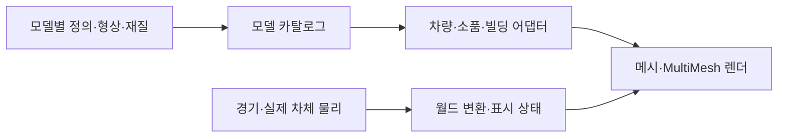

# 아키텍처

역할별 폴더와 헬퍼 배치의 정본은 [코딩 규칙](CODING_STYLE.md#런타임-폴더)입니다. 모델 팩은 `models/`에, 실행 조정자는 `scripts/`의 소유 영역에 둡니다.

## 실행과 주행

진입 씬은 `scenes/race.tscn`입니다. [race.gd](../scripts/race/race.gd)가 모드·경기 상태·화면 전환을 조정하고 [hud.gd](../scripts/ui/hud.gd)가 주행 화면 표시와 터치 좌표를 담당하고 홈·코스 선택·설정·차고 화면은 [hud_menus.gd](../scripts/ui/hud_menus.gd)(`hud.menus`)가 같은 캔버스에 그립니다. 화면 상태 값은 [race_state.gd](../scripts/race/race_state.gd)의 상수가 정본이며 `race.state`는 선언된 값만 받습니다. [race.gd](../scripts/race/race.gd)는 세 보조 객체에 일을 맡깁니다: [race_input.gd](../scripts/input/race_input.gd)(`race.controls`, 키보드·게임패드·터치 입력을 화면별 동작으로 연결), [race_lighting.gd](../scripts/rendering/race_lighting.gd)(`race.lighting`, 하늘·안개·조명과 지역·날씨 전환), [web_shell.gd](../scripts/platform/web_shell.gd)(`race.shell`, 브라우저 전체화면·뒤로 가기·화면 방향).

| 영역 | 책임과 정본 |
| --- | --- |
| 차체 물리 | [world_car.gd](../scripts/physics/world_car.gd): 실제 위치·방향·접지·벽 충돌·공중 운동 |
| 경기·CPU 차량 | [world_race.gd](../scripts/race/world_race.gd): 차체 생성, 조향·속도 판단, 순위·복구·카메라. 상대 차량 상태는 [rival_state.gd](../scripts/race/rival_state.gd)의 타입 있는 객체 |
| 투어 | [tour_world_race.gd](../scripts/race/tour_world_race.gd), [tour_progress.gd](../scripts/race/tour_progress.gd), [track.gd](../scripts/track/track.gd): 열린 도로 계측·분기·체크포인트·제한시간 |
| 서킷 | [circuit_track.gd](../scripts/track/circuit_track.gd), 코스별 `*_course.gd`, [circuit_progress.gd](../scripts/race/circuit_progress.gd): 코스 형상과 순서 있는 게이트·랩 |
| 도로 | [road_section.gd](../scripts/track/road_section.gd), [world_assets.gd](../scripts/rendering/world_assets.gd), [world_collision.gd](../scripts/physics/world_collision.gd): GLB·씬 연결, 공통 좌표·폭·뱅킹과 실제 충돌체 |
| 기믹 | [road_features.gd](../scripts/track/road_features.gd), [bridge_collapse.gd](../scripts/environment/bridge_collapse.gd), [rockfall_hazard.gd](../scripts/environment/rockfall_hazard.gd), [rock_arches.gd](../scripts/environment/rock_arches.gd) |
| 시각 모델 | `models/`의 개별 팩과 [car.gd](../scripts/vehicles/car.gd)·[regional_props_3d.gd](../scripts/environment/regional_props_3d.gd)·[urban_architecture.gd](../scripts/environment/urban_architecture.gd) 어댑터 |
| 배치·풍경 | [roadside_art.gd](../scripts/environment/roadside_art.gd), [settlement_layout.gd](../scripts/environment/settlement_layout.gd), 코스별 `*_environment.gd`, [scenic_landmarks.gd](../scripts/environment/scenic_landmarks.gd) |
| 차량 규칙·소리 | [vehicle_catalog.gd](../scripts/vehicles/vehicle_catalog.gd), [nitro_system.gd](../scripts/race/nitro_system.gd), [vehicle_audio.gd](../scripts/audio/vehicle_audio.gd), [racing_audio.gd](../scripts/audio/racing_audio.gd) |
| 공용 렌더 | [render_resources.gd](../scripts/rendering/render_resources.gd), [render_budget.gd](../scripts/rendering/render_budget.gd), [tunnel_lights.gd](../scripts/rendering/tunnel_lights.gd) |

투어의 다음 두 분기는 `models/world/`의 GLB·씬·주행 프로필을 읽습니다. 진입420m 이후 지나온 구간을 먼저 해제하고 GLB·씬의 읽기를 미리 요청합니다. 읽는 동안 기다리지 않고, 메시 연결·상태 복원·자식 배치를8개 노드 단위 작업으로 나눕니다. [road_section.gd](../scripts/track/road_section.gd)의 큐를 `maintain()`이 프레임별 약1.5ms 예산으로 진행하며 실제 충돌체 등록 후 표시합니다. 갈림길1,200m 앞이나 분기 진입 시 남은 단계를 마칩니다. 준비 중 취소한 구간의 임시 씬과 미리 읽은 참조도 해제합니다. 처음 출발과 코스 전환은 로딩 화면 뒤에서 같은 단계를 한 번에 실행합니다.

투어와 트랙은 같은 `CharacterBody3D`와 실제 노면·장벽 물리를 사용합니다. 도로 곡선은 경기 계측과 CPU 판단에 사용하며 플레이어 차체를 매 프레임 곡선 위로 강제 이동시키지 않습니다. 실제 차체 중력은 [drive_tuning.gd](../scripts/physics/drive_tuning.gd)의 `WORLD_GRAVITY`를 공유하며 명목 점프 설계용 중력과 구분합니다. 단위는 미터·초이고 차량 충돌 기준은 약2.1×1.3×4.3m입니다.

## 모델과 런타임의 경계

`models/<분류>/<id>/definition.tres`를 `model_catalog.gd`가 탐색합니다. ID·치수·경로 같은 작은 정의만 캐시하며 목록 조회로 모든 메시·텍스처를 불러오지 않습니다. 정렬과 ID 조회도 한 번 만든 목록·사전을 재사용합니다.

- `vehicles`: GLB 차체·네 휠 피벗·브레이크등·가동 스포일러. [car.gd](../scripts/vehicles/car.gd)는 주행 효과·전조등·애니메이션을 연결합니다. 차고와 주행은 같은 [vehicle_factory.gd](../scripts/vehicles/vehicle_factory.gd)를 사용합니다. 형상과 정점 표면 자료는 미리 저장되어 있으며 도장·브레이크 상태만 차량별로 구분합니다.
- `props`: 단일 표면 GLB와 전용 재질. [regional_props_3d.gd](../scripts/environment/regional_props_3d.gd)가 공간별 MultiMesh·표시 거리·재질을 연결합니다.
- `buildings`: GLB 조립 파츠·치수 범위·외장 선택. 실제 도시 배치는 코스 씬이 소유합니다.
- `vegetation`: SJRPG에서 가져온 GLB와 두 표면·LOD. 생성형 수피·잎 재질을 공유합니다.
- `world`: 서킷5개와 투어 진입 변형43개. `geometry.glb`·`model.tscn`·`profile.tres`가 형상·배치·주행 자료를 함께 소유합니다.
- `models/shared`: 정적 씬 로더·상태 연결 계약과 효과용 GLB입니다. 런타임에 정점을 생성하는 빌더는 없습니다.
- `model_sources`: 내보내기에서 제외한 편집 원본·보호 해시 목록입니다. [원본 관리 규칙](../model_sources/README.md)에 따라 보존하며 실행 참조가 없어도 삭제하지 않습니다. 생성기는 코스 정점의 전체 속성이 같을 때만 병합하고 공통 식생을 별도 GLB로 연결합니다. LOD·그림자·삼각형 수는 유지합니다.

모델 팩은 주행 파라미터·순위·오디오·코스 배치를 소유하지 않습니다. 새 시각 모델은 자동 등록되고 단독 검사·미리보기가 가능하며, 플레이 가능한 차량 추가나 새 지역 배치는 해당 시스템의 통합 커밋에서 수행합니다. 구체적인 계약과 분업 절차는 [MODEL_PIPELINE.md](MODEL_PIPELINE.md)를 따릅니다.

## 배치와 충돌

모델은 자신의 형상과 치수를 제공하고, 배치 시스템이 실제 AABB·반경으로 도로·가드레일 이격을 계산합니다. 생활 건물은 마을 구획에 모으고 터널·다리·협곡 접근부를 비웁니다. 광고판·식생은 별도 배치 규칙을 사용합니다.

도로·가드레일·점프대·승용차·트럭·붕괴 상판의 주행 충돌은 공통 도로·기믹 코드가 만듭니다. 정적 모델 팩에 임의의 물리·카메라·광원·입력 스크립트를 넣지 않습니다. 붕괴·낙석은 시각 상태와 실제 충돌층을 함께 바꾸며 재시작 때 복구합니다.

복구 후보 검사는 [road_recovery.gd](../scripts/race/road_recovery.gd)가 담당하고 자동·수동·상대 차량 복구가 같은 결과를 사용합니다. 저장된 도로 좌표를 그대로 신뢰하지 않으며 실제 지지 면적·전방 노면·차체 여유를 복구 시점에 검사합니다. 움직이거나 사라질 노면의 실제 충돌체에는 `recovery_unsafe` 메타데이터를 지정해 복구 후보에서 제외합니다. 일반 주행 프레임에는 이 탐색을 실행하지 않습니다.

## 렌더 자원과 수명

- 쿼드와 면별 UV가 있는 단위 상자는 [render_resources.gd](../scripts/rendering/render_resources.gd)에서 공유합니다. 인스턴스는 공유 메시의 크기나 재질을 수정하지 않습니다.
- 소품은180m 공간 단위·배치당12개 이하로 나눕니다. 무제한 크기의 MultiMesh AABB로 화면 밖 전체 월드를 제출하지 않습니다.
- 차체·타이어·림의 조립은 GLB에 저장합니다. 실행 중 메시를 병합하거나 UV·정점 자료를 다시 굽지 않습니다.
- 일반 교통 차량은 차종별 완성된 시각 씬과 좌우 바퀴 메시를 재사용합니다. 색은 셰이더의 차량별 도장 유니폼으로 구분하며 주행하지 않는 교통 차량에는 드리프트 파티클을 생성하지 않습니다. 캐시는 차종 수에 한정하고 마지막 게임 씬 종료 때 비웁니다.
- 코스 전환 때 전용 광고·모델 캐시를 비웁니다. 게임 씬이 여러 개면 공유 캐시를 유지하고 마지막 씬 종료 때 메시·광고·소품 캐시의 강한 참조를 해제합니다.
- 공통 코스 식생은 `world_geometry_map.gd`의 노드 연결표로 읽습니다. `RenderResources`는 7종 공통 씬과 재질 속성이 같은 바인딩 메시를 공유합니다. 원본 GLB와 `.tscn`의 논리 노드 이름은 유지하고, 실제 배포 파일만 변경합니다. 마지막 소유자가 나가면 연결표·공통 씬·바인딩 메시를 함께 비웁니다.
- 타이어 자국1536개, 충돌 파티클4세트, 물보라6개는 고정 풀입니다. 도로 밖 낙석은 지점별24개를 한 MultiMesh로 그리고 도로 안24개 중9개만 잔해와 실제 충돌체를 유지합니다. 착지 후에는 변환 갱신을 멈춥니다.
- 차량 물리 LOD는 가까운 차를 매 틱, 중거리를 번갈아, 원거리를 간소화합니다. 공중·충돌 차량은 실제 시뮬레이션을 유지합니다. 터널은 가까운 광원6개까지만 켭니다.

큰 재질·외벽은 GPU 압축과 밉맵을 사용합니다. 웹은 S3TC·ETC2를 함께, Android는 ETC2만 포함합니다. 하늘·메뉴의 그라데이션은 손실 WebP로 가져옵니다. 상자형 강재·콘크리트는 실제 미터 크기로 보정한 면별 UV를 쓰고 암벽·곡면은 삼면 투영을 사용합니다.

Compatibility 렌더러에서는 소품의 정점색을 보존하도록 MultiMesh의 흰색 인스턴스 색상 버퍼를 유지합니다. 하늘은 실제 월드 표시·프리워밍 시 생성하고 차고는 직접 준비 상태로 재설정해, 첫 렌더 전 하늘 교체에서 발생할 수 있는 큐브맵 누적 경로를 피합니다. Emscripten의 해제된 GL ID 슬롯과 WASM 힙의 확보 크기는 실제 살아 있는 GPU 객체·노드 누수와 구분해서 계측합니다.

## 버전과 출력물

[app_version.gd](../scripts/platform/app_version.gd)와 `addons/app_version/`이 로딩·메인·설정 버전을 일치시킵니다. 웹은 프로젝트 버전·커밋, Android는 내보내기 프리셋의 버전명·번호를 사용합니다. 내보내기 플러그인은 작업 후 설정을 복원합니다.

성능 수치·스크린샷·일회성 검토는 `build/reports/`, 배포 결과는 `build/site/`·`build/android/`에 생성합니다. 현재 동작·계약은 문서와 검사에 두고 과거 변경 이력은 Git으로 확인합니다.

## 주행 효과와 입체 재질

[boost_exhaust.gd](../scripts/effects/boost_exhaust.gd)는 배기구에 고정된 GLB 화염·잔광을 재사용하며 월드 좌표에 잔류하는 니트로 입자를 만들지 않습니다. 차량 모델별 화염·빔의 굵기·길이·색과 단발·셀 발동 순간의 화염 포락선을 분리합니다. 연속 부스트의3.2초 열 상태는 가동 스포일러·카메라의 시야각·추격 거리에도 전달됩니다. 일시정지는 시간 진행을 멈추고 복구·재시작은 `Car.reset_driving_effects()`로 비웁니다. 차체 보호 재질은 플레이어가 복제해 소유하므로 상대 차량의 공유 재질을 바꾸지 않습니다.

실제 차체 층은 도로1·가드2·차량4·파손 장애물8·보호 플레이어16으로 구분합니다. 일반 차체 마스크는15, 보호 플레이어는3입니다. 보호 상태에서만 실제 노면이 없는 경우 도로 프로필에 한정한 임시 접지를 허용하고, 일반 주행·복구 위치 선정은 실제 충돌체를 계속 검사합니다. [road_debris.gd](../scripts/physics/road_debris.gd)는 바위의 형상·충돌을 함께 제거하고 재시작 때 복원합니다. GLB 트럭 외형은 기존 팩에 두고 [tour_traffic.gd](../scripts/race/tour_traffic.gd)의 실제 이동 차체와 연결합니다.

[tire_trails.gd](../scripts/effects/tire_trails.gd)는 실제 후륜 접점 두 곳을 광선으로 확인하고 노면 법선에 맞춘 자국을1536개 순환 풀·1회 드로로 남깁니다. 공중·저속·도로 밖에서는 끊고, 드리프트와 고속 제동에서 농도를 달리합니다. 자국은18~38초에 사라지며 풀이 차면 오래된 것부터 덮어씁니다.

[surface_relief.gdshaderinc](../shaders/surface_relief.gdshaderinc)는 기존 생성형 이미지의 미분으로 미세 표면 법선을 보강합니다. 추가 텍스처 샘플·SSAO·전체 화면 후처리를 만들지 않습니다. 음영은 실제 깊이 메시를 대신하지 않으며, 도시 빌딩·항만 창고의 모서리와 옥상 테두리는 [urban_architecture.gd](../scripts/environment/urban_architecture.gd)의 실제 두께 있는 부품을180m 공간별 MultiMesh로 묶습니다. 사암·현무암 팩도 같은 생성형 암석 이미지를 전용 재질로 참조하며 색·채도를 구분합니다. 근거리 건물·바위 소품은 태양 그림자를 만들고 나무·광고판의 대량 그림자는 생략합니다. 모든 그림자의 범위는 화질별75~220m입니다.

## 같은 모델의 외벽 변형

[facade_variants.gd](../scripts/environment/facade_variants.gd)는 도시12종 형상에 기본·석회암 계열·클링커 계열의3스킨을 배정합니다. 형상 목록을 한 번 순환할 때마다 다음 스킨을 선택하므로12종과3세트가 배수여도 같은 모델의 이미지가 고정 반복되지 않습니다. `INSTANCE_CUSTOM.a`에 스킨과 색 변형을 함께 담고 한 건물의 조립 파츠가 같은 값을 사용합니다. 근거리·원거리 도시는 [urban_architecture.gd](../scripts/environment/urban_architecture.gd)의 이미지 바인딩을 공유합니다. 산업용 항만 창고의 전용 셀은 유지합니다.

일반 건물의 정면·측면은 기본과 대체 이미지2세트를 `INSTANCE_CUSTOM.b`로 선택합니다. 위치·종류 기반의 고정 선택이며 배치의 선택적 `skin: 0|1`로 지정할 수 있습니다. 앞면과 옆면은 같은 번호를 사용합니다. 이미지가 다른 동일 모델도 같은 MultiMesh·메시·재질을 공유하고 이미지 수 때문에 배치를 늘리지 않습니다. 추가 아틀라스는 해당 외벽을 실제로 사용하는 종류·지역만 미리 읽고, 마지막 씬 해제 시 기존 캐시 수명에 따라 놓습니다. 외벽 픽셀은 선택한 이미지 한 장만 샘플링하며 밝기 미분의 요철을 재사용합니다.

## 첫 렌더 준비

[material_warmup.gd](../scripts/rendering/material_warmup.gd)는 파일 미리 읽기 다음에 실제 메시·재질·MultiMesh 변형을 작은 독립 뷰포트에서 렌더합니다. 투어 첫 로딩에서 공간 셰이더를 준비해 마지막 게임 씬까지 보유하며 일반 트랙은 해당 코스의 실제 재질만 준비합니다. 폐회로는 실제 카메라 시점도 순회해 첫 업로드·글꼴·조명 준비를 로딩 화면 뒤에서 끝냅니다. 카메라와 물리 처리 상태를 복원하며 랩·차량 위치는 바꾸지 않습니다. 투어의 다음 구간은 물리 등록 뒤 프레임마다 재질 두 묶음씩 준비한 후 공개합니다. 임시 뷰포트·메시 참조는 준비 완료나 구간 해제 때 함께 사라지고 마지막 렌더 소유자가 나가면 공통 준비 상태도 비웁니다.
