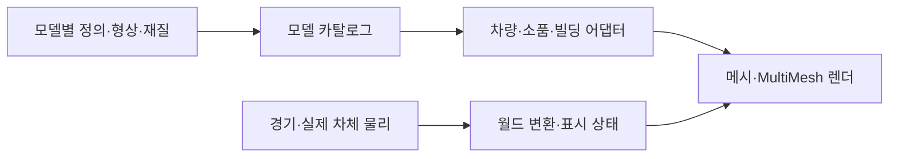

# 아키텍처

## 실행과 주행

진입 씬은 `scenes/race.tscn`입니다. `race.gd`가 화면·입력·모드·경기 상태를 조정하고 `hud.gd`가 표시와 터치 좌표를 담당합니다.

| 영역 | 책임과 정본 |
| --- | --- |
| 차체 물리 | `world_car.gd`: 실제 위치·방향·접지·벽 충돌·공중 운동 |
| 경기·CPU 차량 | `world_race.gd`: 차체 생성, 조향·속도 판단, 순위·복구·카메라 |
| 투어 | `tour_world_race.gd`, `tour_progress.gd`, `track.gd`: 열린 도로 계측·분기·체크포인트·제한시간 |
| 서킷 | `circuit_track.gd`, 코스별 `*_course.gd`, `circuit_progress.gd`: 코스 형상과 순서 있는 게이트·랩 |
| 도로 | `road_section.gd`, `roadside_geometry.gd`, `fuji_collision.gd`: 공통 좌표·폭·뱅킹과 실제 충돌체 |
| 기믹 | `road_features.gd`, `bridge_collapse.gd`, `rockfall_hazard.gd`, `rock_arches.gd` |
| 시각 모델 | `models/`의 개별 팩과 `car.gd`·`regional_props_3d.gd`·`urban_architecture.gd` 어댑터 |
| 배치·풍경 | `roadside_art.gd`, `settlement_layout.gd`, 코스별 `*_environment.gd`, `scenic_landmarks.gd` |
| 차량 규칙·소리 | `vehicle_catalog.gd`, `nitro_system.gd`, `vehicle_audio.gd`, `racing_audio.gd` |
| 공용 렌더 | `render_resources.gd`, `render_budget.gd`, `tunnel_lights.gd` |

투어의 다음 분기 도로 두 개는 주행 중에 만들어집니다. `track.gd`는 지나온 구간을 먼저 해제한 뒤(진입 420m 이후) 새 구간의 곡선만 즉시 만들고, 메시·풍경·충돌체는 `road_section.gd`의 단계 큐(`build_queue`)에 쌓아 `maintain()`이 프레임마다 약 1.5ms씩 실행합니다. 완성 전 구간은 숨겨 두며 충돌체 등록 뒤에 표시합니다. 긴 띠 메시는 표본 범위별로, 충돌체는 수집·장벽 구간·등록으로 나눕니다. 갈림길 1,200m 앞이나 분기 진입 시점까지 남은 단계는 한 번에 끝냅니다. 처음 출발과 코스 전환은 로딩 화면 뒤에서 같은 단계를 한 번에 실행합니다.

투어와 트랙은 같은 `CharacterBody3D`와 실제 노면·장벽 물리를 사용합니다. 도로 곡선은 경기 계측과 CPU 판단에 사용하며 플레이어 차체를 매 프레임 곡선 위로 강제 이동시키지 않습니다. 단위는 미터·초이고 차량 충돌 기준은 약2.1×1.3×4.3m입니다.

## 모델과 런타임의 경계

`models/<분류>/<id>/definition.tres`를 `model_catalog.gd`가 탐색합니다. ID·치수·경로 같은 작은 정의만 캐시하며 목록 조회로 모든 메시·텍스처를 불러오지 않습니다. 정렬과 ID 조회도 한 번 만든 목록·사전을 재사용합니다.

- `vehicles`: 개별 차체와 시각적 바퀴 치수·림·렌즈 위치. `car.gd`는 공통 휠·연기·부스터·전조등·애니메이션을 연결합니다. 차고와 주행은 같은 `vehicle_factory.gd`를 사용합니다.
- `props`: 단일 표면의 메시와 전용 재질. `regional_props_3d.gd`가 경계·거리별 표시·공간 배치를 처리합니다.
- `buildings`: 도시 빌딩의 파츠 조립·치수 범위·외장 선택. `urban_architecture.gd`를 통해 `road_biome.gd`가 배치합니다.
- `models/shared`: 모델 선택을 포함하지 않는 기하·파일 로더입니다. 개별 모델 제작자가 수정할 필요가 없도록 API를 유지합니다.

모델 팩은 주행 파라미터·순위·오디오·코스 배치를 소유하지 않습니다. 새 시각 모델은 자동 등록되고 단독 검사·미리보기가 가능하며, 플레이 가능한 차량 추가나 새 지역 배치는 해당 시스템의 통합 커밋에서 수행합니다. 구체적인 계약과 분업 절차는 [MODEL_PIPELINE.md](MODEL_PIPELINE.md)를 따릅니다.

## 배치와 충돌

모델은 자신의 형상과 치수를 제공하고, 배치 시스템이 실제 AABB·반경으로 도로·가드레일 이격을 계산합니다. 생활 건물은 마을 구획에 모으고 터널·다리·협곡 접근부를 비웁니다. 광고판·식생은 별도 배치 규칙을 사용합니다.

도로·가드레일·점프대·트럭·붕괴 상판의 주행 충돌은 공통 도로·기믹 코드가 만듭니다. 정적 모델 팩에 임의의 물리·카메라·광원·입력 스크립트를 넣지 않습니다. 붕괴·낙석은 시각 상태와 실제 충돌층을 함께 바꾸며 재시작 때 복구합니다.

## 렌더 자원과 수명

- 쿼드와 면별 UV가 있는 단위 상자는 `render_resources.gd`에서 공유합니다. 인스턴스는 공유 메시의 크기나 재질을 수정하지 않습니다.
- 소품은180m 공간 단위·배치당12개 이하로 나눕니다. 무제한 크기의 MultiMesh AABB로 화면 밖 전체 월드를 제출하지 않습니다.
- `car.gd`는 무텍스처 정적 부품만 재질별로 병합합니다. 외부 모델의 UV·텍스처·ShaderMaterial·다중 표면은 유지합니다.
- 코스 전환 때 전용 광고·모델 캐시를 비웁니다. 게임 씬이 여러 개면 공유 캐시를 유지하고 마지막 씬 종료 때 메시·광고·소품 캐시의 강한 참조를 해제합니다.
- 스키드 자국160개, 충돌 파티클4세트, 물보라6개는 고정 풀입니다. 도로 밖 낙석은 지점별14개를 한 MultiMesh로 그리고 도로 안9개만 실제 충돌체를 가집니다. 착지 후에는 변환 갱신을 멈춥니다.
- 차량 물리 LOD는 가까운 차를 매 틱, 중거리를 번갈아, 원거리를 간소화합니다. 공중·충돌 차량은 실제 시뮬레이션을 유지합니다. 터널은 가까운 광원6개까지만 켭니다.

큰 재질·외벽은 GPU 압축과 밉맵을 사용합니다. 웹은 S3TC·ETC2를 함께, Android는 ETC2만 포함합니다. 하늘·메뉴의 그라데이션은 손실 WebP로 가져옵니다. 상자형 강재·콘크리트는 실제 미터 크기로 보정한 면별 UV를 쓰고 암벽·곡면은 삼면 투영을 사용합니다.

Compatibility 렌더러에서는 소품의 정점색을 보존하도록 MultiMesh의 흰색 인스턴스 색상 버퍼를 유지합니다. 하늘은 실제 월드 표시·프리워밍 시 생성하고 차고는 직접 준비 상태로 재설정해, 첫 렌더 전 하늘 교체에서 발생할 수 있는 큐브맵 누적 경로를 피합니다. Emscripten의 해제된 GL ID 슬롯과 WASM 힙의 확보 크기는 실제 살아 있는 GPU 객체·노드 누수와 구분해서 계측합니다.

## 버전과 출력물

`app_version.gd`와 `addons/app_version/`이 로딩·메인·설정 버전을 일치시킵니다. 웹은 프로젝트 버전·커밋, Android는 내보내기 프리셋의 버전명·번호를 사용합니다. 내보내기 플러그인은 작업 후 설정을 복원합니다.

성능 수치·스크린샷·일회성 검토는 `build/reports/`, 배포 결과는 `build/site/`·`build/android/`에 생성합니다. 현재 동작·계약은 문서와 검사에 두고 과거 변경 이력은 Git으로 확인합니다.
