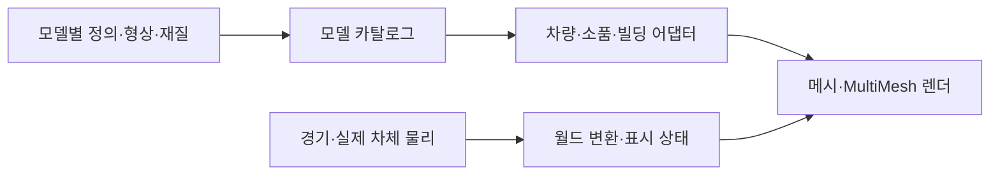

# 아키텍처

역할별 폴더와 헬퍼 배치의 정본은 [코딩 규칙](CODING_STYLE.md#런타임-폴더)입니다. 모델 팩은 `models/`에, 실행 조정자는 `scripts/`의 소유 영역에 둡니다.

## 실행과 주행

시작 씬은 [boot.tscn](../scenes/boot.tscn)이며 스플래시를 그린 뒤 실제 게임 [race.tscn](../scenes/race.tscn)을 엽니다. [race.gd](../scripts/race/race.gd)가 모드·경기 상태·화면 전환을 조정하고 [hud.gd](../scripts/ui/hud.gd)가 주행 화면 표시와 터치 좌표를 담당하고 홈·코스 선택·설정·차고 화면은 [hud_menus.gd](../scripts/ui/hud_menus.gd)(`hud.menus`)가 같은 캔버스에 그립니다. 화면 상태 값은 [race_state.gd](../scripts/race/race_state.gd)의 상수가 정본이며 `race.state`는 선언된 값만 받습니다. [race.gd](../scripts/race/race.gd)는 세 보조 객체에 일을 맡깁니다: [race_input.gd](../scripts/input/race_input.gd)(`race.controls`, 키보드·게임패드·터치 입력을 화면별 동작으로 연결), [race_lighting.gd](../scripts/rendering/race_lighting.gd)(`race.lighting`, 하늘·안개·조명과 지역·날씨 전환), [web_shell.gd](../scripts/platform/web_shell.gd)(`race.shell`, 브라우저 전체화면·뒤로 가기·화면 방향).

| 영역 | 책임과 정본 |
| --- | --- |
| 차체 물리 | [world_car.gd](../scripts/physics/world_car.gd): 실제 위치·방향·접지·벽 충돌·공중 운동 |
| 경기·CPU 차량 | [world_race.gd](../scripts/race/world_race.gd): 차체 생성, 조향·속도 판단, 순위·복구·카메라. 상대 차량 상태는 [rival_state.gd](../scripts/race/rival_state.gd)의 타입 있는 객체 |
| 투어 | [tour_world_race.gd](../scripts/race/tour_world_race.gd), [tour_progress.gd](../scripts/race/tour_progress.gd), [track.gd](../scripts/track/track.gd): 열린 도로 계측·분기·체크포인트·제한시간 |
| 서킷 | [circuit_track.gd](../scripts/track/circuit_track.gd), 코스별 `*_course.gd`, [circuit_progress.gd](../scripts/race/circuit_progress.gd): 코스 형상과 순서 있는 게이트·랩 |
| 도로 | [road_section.gd](../scripts/track/road_section.gd), [world_assets.gd](../scripts/rendering/world_assets.gd), [world_collision.gd](../scripts/physics/world_collision.gd): GLB·씬 연결, 공통 좌표·폭·뱅킹과 실제 충돌체 |
| 기믹 | [road_features.gd](../scripts/track/road_features.gd), [bridge_collapse.gd](../scripts/environment/bridge_collapse.gd), [rockfall_hazard.gd](../scripts/environment/rockfall_hazard.gd), [rock_arches.gd](../scripts/environment/rock_arches.gd) |
| 시각 모델 | `models/`의 개별 팩과 [car.gd](../scripts/vehicles/car.gd)·[regional_props_3d.gd](../scripts/environment/regional_props_3d.gd)·[urban_architecture.gd](../scripts/environment/urban_architecture.gd) 어댑터 |
| 배치·풍경 | [roadside_art.gd](../scripts/environment/roadside_art.gd), [settlement_layout.gd](../scripts/environment/settlement_layout.gd), 코스별 `*_environment.gd`, [scenic_landmarks.gd](../scripts/environment/scenic_landmarks.gd) |
| 차량 규칙·소리 | [vehicle_catalog.gd](../scripts/vehicles/vehicle_catalog.gd), [nitro_system.gd](../scripts/race/nitro_system.gd), [vehicle_audio.gd](../scripts/audio/vehicle_audio.gd), [racing_audio.gd](../scripts/audio/racing_audio.gd) |
| 공용 렌더 | [render_resources.gd](../scripts/rendering/render_resources.gd), [render_budget.gd](../scripts/rendering/render_budget.gd), [tunnel_lights.gd](../scripts/rendering/tunnel_lights.gd) |

투어의 다음 두 분기는 `models/world/`의 GLB·씬·주행 프로필을 읽습니다. 진입420m 이후 지나온 구간을 먼저 해제하고 GLB·씬의 읽기를 미리 요청합니다. 읽는 동안 기다리지 않고, 43개 진입 변형의 씬을 24개 이하의 저장 노드 단위로 조립하고, GLB 속성 조회는 24노드·0.5ms, 메시·월드 메타정보 연결은 4노드, 저장 상태 디코딩은 1노드 단위로 나눕니다. 주행 중 재질 미리 렌더는 128×64 뷰포트에 프레임당1개 작업만 올립니다. [road_section.gd](../scripts/track/road_section.gd)의 큐를 `maintain()`이 화면 프레임별 약1.5ms 예산으로 진행하며 실제 충돌체 등록 후 표시합니다. 한 렌더 프레임에 여러 보충 물리 틱이 돌아도 이 준비 예산은 한 번만 사용합니다. 갈림길1,200m 앞에서는 프레임 예산을 3ms로 늘리고, 분기 진입까지 준비가 끝나지 않았을 때만 남은 단계를 마칩니다. 준비 중 취소한 구간의 임시 씬과 미리 읽은 참조도 해제합니다. 처음 출발과 코스 전환은 로딩 화면 뒤에서 같은 단계를 한 번에 실행합니다.

투어와 트랙은 같은 `CharacterBody3D`와 실제 노면·장벽 물리를 사용합니다. 도로 곡선은 경기 계측과 CPU 판단에 사용하며 플레이어 차체를 매 프레임 곡선 위로 강제 이동시키지 않습니다. 실제 차체 중력은 [drive_tuning.gd](../scripts/physics/drive_tuning.gd)의 `WORLD_GRAVITY`를 공유하며 명목 점프 설계용 중력과 구분합니다. 단위는 미터·초이고 차량 충돌 기준은 약2.1×1.3×4.3m입니다.

시각 하중은 [body_motion.gd](../scripts/effects/body_motion.gd)의 고정 크기 스프링 상태만 보유합니다. 공통 주행이 실제 속도를 한 번 샘플링하고 [car.gd](../scripts/vehicles/car.gd)가 GLB 시각 피벗에만 적용합니다. [vehicle_sound_state.gd](../scripts/audio/vehicle_sound_state.gd)는 부하·변속·보상 사건을 관측하고 [vehicle_audio.gd](../scripts/audio/vehicle_audio.gd)의 믹스가 네이티브와 웹에 동일하게 전달됩니다. 보상은 주행 규칙이 한 번 지급하고 피드백 관측자는 점수·물리를 수정하지 않습니다.

[chase_camera_state.gd](../scripts/effects/chase_camera_state.gd)는 현재 도로의 시선 예고와 작은 가감속 거리 보정을 담당하며 실제 위치 추적·충돌 회피는 `WorldRace`에 둡니다. [proximity_audio_state.gd](../scripts/audio/proximity_audio_state.gd)는 물리 틱에서 상대 위치·속도를 관측합니다. 관측은 최대32개 ID와 스칼라만 보유하고 지역·노드 참조를 붙잡지 않습니다. 순간이동은 두 상태를 초기화합니다.

[spatial_driving_audio.gd](../scripts/audio/spatial_driving_audio.gd)는 네이티브의 통과·후류 두 보이스와 고유 이름의 패닝 버스 두 개를 생성하고 종료 시 함께 해제합니다. 웹의 `file_audio.js`는 같은 패닝·피치·사건 번호를 읽고 `StereoPannerNode`로 재생합니다. 통과음은 동시에 하나만 유지하며 종료·교체·음소거 때 연결을 해제합니다. 차량16대나 새로운 지역 진입 때문에 음향 노드를 추가하지 않습니다.

[slipstream_state.gd](../scripts/race/slipstream_state.gd)는 공통 주행에서 실제 후류 대상을 선택하고 충전·준비·같은 차의 실제 추월을 검증합니다. 상태는 ID·시간·벡터만 보유하고 대상 노드를 붙잡지 않습니다. 기존 `DrivingRewards.announce()`에 성공 사건을 전달하며 추월 점수는 기존 주행 규칙에 둡니다. HUD는 같은 상태로 진행 막대와 대상 표식을 그립니다.

[environment_audio_state.gd](../scripts/audio/environment_audio_state.gd)는 현재 도로·실제 차량 높이로 닫힌 정도와 잔향 혼합을 보간합니다. 네이티브 [environment_audio.gd](../scripts/audio/environment_audio.gd)는 차량·공기 루프의 공유 잔향 버스 한 개를 소유하고, 웹 [environment_audio.js](../web/environment_audio.js)는 고정 반사 경로 두 개를 소유합니다. 점화·충돌·UI 단발음은 이 버스를 거치지 않습니다. 네이티브 패닝 두 버스는 공유 잔향 버스로 보내고, 종료 시 세 버스를 모두 해제합니다. 구간마다 노드·IR 버퍼를 만들지 않으며 거의 같은 DSP 매개변수를 반복 예약하지 않습니다.

## 모델과 런타임의 경계

`models/<분류>/<id>/definition.tres`를 `model_catalog.gd`가 탐색합니다. ID·치수·경로 같은 작은 정의만 캐시하며 목록 조회로 모든 메시·텍스처를 불러오지 않습니다. 정렬과 ID 조회도 한 번 만든 목록·사전을 재사용합니다.

- `vehicles`: GLB 차체·네 휠 피벗·브레이크등·가동 스포일러. [car.gd](../scripts/vehicles/car.gd)는 주행 효과·전조등·애니메이션을 연결합니다. 차고와 주행은 같은 [vehicle_factory.gd](../scripts/vehicles/vehicle_factory.gd)를 사용합니다. 형상과 정점 표면 자료는 미리 저장되어 있으며 도장·브레이크 상태만 차량별로 구분합니다.
- `props`: 단일 표면 GLB와 전용 재질. [regional_props_3d.gd](../scripts/environment/regional_props_3d.gd)가 공간별 MultiMesh·표시 거리·재질을 연결합니다.
- `buildings`: GLB 조립 파츠·치수 범위·외장 선택. 실제 도시 배치는 코스 씬이 소유합니다.
- `vegetation`: SJRPG에서 가져온 GLB와 두 표면·LOD. 생성형 수피·잎 재질을 공유합니다.
- `world`: 서킷5개와 투어 진입 변형43개. `geometry.glb`·`model.tscn`·`profile.tres`가 형상·배치·주행 자료를 함께 소유합니다.
- `models/shared`: 정적 씬 로더·상태 연결 계약과 효과용 GLB입니다. 런타임에 정점을 생성하는 빌더는 없습니다.
- `model_sources`: 내보내기에서 제외한 편집 원본·보호 해시 목록입니다. [원본 관리 규칙](../model_sources/README.md)에 따라 보존하며 실행 참조가 없어도 삭제하지 않습니다. 생성기는 코스 정점의 전체 속성이 같을 때만 병합하고 공통 식생을 별도 GLB로 연결합니다. LOD·그림자·삼각형 수는 유지합니다.

모델 팩은 주행 파라미터·순위·오디오·코스 배치를 소유하지 않습니다. 새 시각 모델은 자동 등록되고 단독 검사·미리보기가 가능하며, 플레이 가능한 차량 추가나 새 지역 배치는 해당 시스템의 통합 커밋에서 수행합니다. 구체적인 계약과 분업 절차는 [MODEL_PIPELINE.md](MODEL_PIPELINE.md)를 따릅니다.

## 배치와 충돌

모델은 자신의 형상과 치수를 제공하고, 배치 시스템이 실제 AABB·반경으로 도로·가드레일 이격을 계산합니다. 생활 건물은 마을 구획에 모으고 터널·다리·협곡 접근부를 비웁니다. 광고판·식생은 별도 배치 규칙을 사용합니다.

도로·가드레일·점프대·승용차·트럭·붕괴 상판의 주행 충돌은 공통 도로·기믹 코드가 만듭니다. 정적 모델 팩에 임의의 물리·카메라·광원·입력 스크립트를 넣지 않습니다. 붕괴·낙석은 시각 상태와 실제 충돌층을 함께 바꾸며 재시작 때 복구합니다.

복구 성공 뒤 보상 취소·구간 무효화·복구 횟수 집계는 공통 `WorldRace.recover_player()`에서 한 번 수행합니다. 자동 낙하와 수동 버튼이 같은 처리를 사용합니다.

복구 후보 검사는 [road_recovery.gd](../scripts/race/road_recovery.gd)가 담당하고 자동·수동·상대 차량 복구가 같은 결과를 사용합니다. 저장된 도로 좌표를 그대로 신뢰하지 않으며 실제 지지 면적·전방 노면·차체 여유를 복구 시점에 검사합니다. 움직이거나 사라질 노면의 실제 충돌체에는 `recovery_unsafe` 메타데이터를 지정해 복구 후보에서 제외합니다. 일반 주행 프레임에는 이 탐색을 실행하지 않습니다.

## 렌더 자원과 수명

- 쿼드와 면별 UV가 있는 단위 상자는 [render_resources.gd](../scripts/rendering/render_resources.gd)에서 공유합니다. 인스턴스는 공유 메시의 크기나 재질을 수정하지 않습니다.
- 소품은 180m 공간 단위·배치당12개 이하로 나눕니다. 무제한 크기의 MultiMesh AABB로 화면 밖 전체 월드를 제출하지 않습니다.
- 차체·타이어·림의 조립은 GLB에 저장합니다. 실행 중 메시를 병합하거나 UV·정점 자료를 다시 굽지 않습니다.
- 일반 교통 차량은 차종별 완성된 시각 씬과 좌우 바퀴 메시를 재사용합니다. 색은 셰이더의 차량별 도장 유니폼으로 구분하며 주행하지 않는 교통 차량에는 드리프트 파티클을 생성하지 않습니다. 캐시는 차종 수에 한정하고 마지막 게임 씬 종료 때 비웁니다.
- 코스 전환 때 전용 광고·모델 캐시를 비웁니다. 게임 씬이 여러 개면 공유 캐시를 유지하고 마지막 씬 종료 때 메시·광고·소품 캐시의 강한 참조를 해제합니다.
- 공통 코스 식생은 `world_geometry_map.gd`의 노드 연결표로 읽습니다. `RenderResources`는 7종 공통 씬과 재질 속성이 같은 바인딩 메시를 공유합니다. 원본 GLB와 `.tscn`의 논리 노드 이름은 유지하고, 실제 배포 파일만 변경합니다. 마지막 소유자가 나가면 연결표·공통 씬·바인딩 메시를 함께 비웁니다.
- 타이어 자국1536개, 충돌 파티클4세트, 물보라6개는 고정 풀입니다. 도로 밖 낙석은 지점별24개를 한 MultiMesh로 그리고 도로 안24개 중9개만 잔해와 실제 충돌체를 유지합니다. 착지 후에는 변환 갱신을 멈춥니다.
- 차량 물리 LOD는 가까운 차를 매 틱, 중거리를 번갈아, 원거리를 간소화합니다. 공중·충돌 차량은 실제 시뮬레이션을 유지합니다. 터널은 가까운 광원6개까지만 켭니다.
- 상대 차량의 차선 판단은 15대의 위상을 0.24초 주기 안에 분산하고 복구 때도 유지합니다. 프로필을 따라 이동한 원거리 상대는 그 위치를 다음 계측의 연속 탐색 시작점으로만 전달합니다. 거리·게이트·랩 상태를 덮어쓰지 않으며 실제 위치가 연속성·높이 검사를 통과하지 못하면 전체 탐색으로 돌아갑니다.

큰 재질·외벽은 GPU 압축과 밉맵을 사용합니다. 웹은 S3TC·ETC2를 함께, Android는 ETC2만 포함합니다. 하늘·메뉴의 그라데이션은 손실 WebP로 가져옵니다. 상자형 강재·콘크리트는 실제 미터 크기로 보정한 면별 UV를 쓰고 암벽·곡면은 삼면 투영을 사용합니다.

Compatibility 렌더러에서는 소품의 정점색을 보존하도록 MultiMesh의 흰색 인스턴스 색상 버퍼를 유지합니다. 하늘은 실제 월드 표시·프리워밍 시 생성하고 차고는 직접 준비 상태로 재설정해, 첫 렌더 전 하늘 교체에서 발생할 수 있는 큐브맵 누적 경로를 피합니다. Emscripten의 해제된 GL ID 슬롯과 WASM 힙의 확보 크기는 실제 살아 있는 GPU 객체·노드 누수와 구분해서 계측합니다.

## 버전과 출력물

[app_version.gd](../scripts/platform/app_version.gd)와 `addons/app_version/`이 로딩·메인·설정 버전을 일치시킵니다. 웹은 프로젝트 버전·커밋, Android는 내보내기 프리셋의 버전명·번호를 사용합니다. 내보내기 플러그인은 작업 후 설정을 복원합니다.

성능 수치·스크린샷·일회성 검토는 `build/reports/`, 배포 결과는 `build/site/`·`build/android/`에 생성합니다. 현재 동작·계약은 문서와 검사에 두고 과거 변경 이력은 Git으로 확인합니다.

## 주행 효과와 입체 재질

[boost_exhaust.gd](../scripts/effects/boost_exhaust.gd)는 배기구에 고정된 GLB 화염·잔광을 재사용하며 월드 좌표에 잔류하는 니트로 입자를 만들지 않습니다. 차량 모델별 화염·빔의 굵기·길이·색과 단발·셀 발동 순간의 화염 포락선을 분리합니다. 연속 부스트의3.2초 열 상태는 가동 스포일러·카메라의 시야각·추격 거리에도 전달됩니다. 일시정지는 시간 진행을 멈추고 복구·재시작은 `Car.reset_driving_effects()`로 비웁니다. 차체 보호 재질은 플레이어가 복제해 소유하므로 상대 차량의 공유 재질을 바꾸지 않습니다.

실제 차체 층은 도로 1·가드2·차량4·파손 장애물8·보호 플레이어16으로 구분합니다. 일반 차체 마스크는 15, 보호 플레이어는 3입니다. 보호 상태에서만 실제 노면이 없는 경우 도로 프로필에 한정한 임시 접지를 허용하고, 일반 주행·복구 위치 선정은 실제 충돌체를 계속 검사합니다. [road_debris.gd](../scripts/physics/road_debris.gd)는 바위의 형상·충돌을 함께 제거하고 재시작 때 복원합니다. GLB 트럭 외형은 기존 팩에 두고 [tour_traffic.gd](../scripts/race/tour_traffic.gd)의 실제 이동 차체와 연결합니다.

[tire_trails.gd](../scripts/effects/tire_trails.gd)는 실제 후륜 접점 두 곳을 광선으로 확인하고 노면 법선에 맞춘 자국을 1536개 순환 풀·1회 드로로 남깁니다. 공중·저속·도로 밖에서는 끊고, 드리프트와 고속 제동에서 농도를 달리합니다. 자국은 18~38초에 사라지며 풀이 차면 오래된 것부터 덮어씁니다.

[surface_relief.gdshaderinc](../shaders/surface_relief.gdshaderinc)는 기존 생성형 이미지의 미분으로 미세 표면 법선을 보강합니다. 추가 텍스처 샘플·SSAO·전체 화면 후처리를 만들지 않습니다. 음영은 실제 깊이 메시를 대신하지 않으며, 도시 빌딩·항만 창고의 모서리와 옥상 테두리는 [urban_architecture.gd](../scripts/environment/urban_architecture.gd)의 실제 두께 있는 부품을 180m 공간별 MultiMesh로 묶습니다. 사암·현무암 팩도 같은 생성형 암석 이미지를 전용 재질로 참조하며 색·채도를 구분합니다. 근거리 건물·바위 소품은 태양 그림자를 만들고 나무·광고판의 대량 그림자는 생략합니다. 모든 그림자의 범위는 화질별75~220m입니다.

## 같은 모델의 외벽 변형

[facade_variants.gd](../scripts/environment/facade_variants.gd)는 도시12종 형상에 기본·석회암 계열·클링커 계열의3스킨을 배정합니다. 형상 목록을 한 번 순환할 때마다 다음 스킨을 선택하므로 12종과 3세트가 배수여도 같은 모델의 이미지가 고정 반복되지 않습니다. `INSTANCE_CUSTOM.a`에 스킨과 색 변형을 함께 담고 한 건물의 조립 파츠가 같은 값을 사용합니다. 근거리·원거리 도시는 [urban_architecture.gd](../scripts/environment/urban_architecture.gd)의 이미지 바인딩을 공유합니다. 산업용 항만 창고의 전용 셀은 유지합니다.

일반 건물의 정면·측면은 기본과 대체 이미지2세트를 `INSTANCE_CUSTOM.b`로 선택합니다. 위치·종류 기반의 고정 선택이며 배치의 선택적 `skin: 0|1`로 지정할 수 있습니다. 앞면과 옆면은 같은 번호를 사용합니다. 이미지가 다른 동일 모델도 같은 MultiMesh·메시·재질을 공유하고 이미지 수 때문에 배치를 늘리지 않습니다. 추가 아틀라스는 해당 외벽을 실제로 사용하는 종류·지역만 미리 읽고, 마지막 씬 해제 시 기존 캐시 수명에 따라 놓습니다. 외벽 픽셀은 선택한 이미지 한 장만 샘플링하며 밝기 미분의 요철을 재사용합니다.

## 주행 계산과 모바일 렌더 예산

[circuit_curvature.gd](../scripts/track/circuit_curvature.gd)는 닫힌 코스 프로필을 읽은 뒤 최대0.5m 간격의 수평 곡률 표를 만들고 거리별 선형 보간으로 조회합니다. [circuit_track.gd](../scripts/track/circuit_track.gd)가 코스와 함께 소유하며 재설정 때 교체합니다. 원래 노면 좌표·뱅크·충돌 메시와 투어의 열린 도로 계산은 유지합니다.

곡률 표는 현재 `active.curve`와 `active.length`의 파생 자료입니다. 코스 로드·재설정은 프로필을 먼저 적용하고 새 표를 생성하므로 새 코스나 수정된 프로필도 같은 경로를 사용합니다. 실행 중 곡선 변경을 자동 감지하는 기능은 없습니다. 포인트·제어점·굽기 간격·길이를 바꾸는 동작을 추가한다면 새 형상을 공개하기 전에 표를 다시 만들고 교체해야 합니다. 곡선의 높이 변경도 거리 매개화에 영향을 주므로 재생성 대상입니다. 구체적인 편집·검사 규칙은 [코스 팩의 곡률 캐시 계약](MODEL_PIPELINE.md#곡률-캐시-계약)을 따릅니다.

다리 붕괴·낙석·광고·식생처럼 중심선을 바꾸지 않는 변화에는 곡률 표를 유지합니다. 붕괴 통로·장애물·가용 차선·앞차 상태는 곡률 표에 저장하지 않고 현재 기믹과 교통 상태로 판단합니다. 폭·뱅킹만 바뀌고 중심선과 길이가 그대로라면 수평 곡률의 재생성은 필요하지 않지만 노면·충돌 자료의 일치는 별도로 유지해야 합니다.

[world_race.gd](../scripts/race/world_race.gd)는 150m 밖에서 운반하는 상대 차량의 곡률·앞차 속도 계획만0.12시뮬레이션 초 동안 재사용합니다. 이동·니트로·노면 타이머는 매 틱 진행하고 근접·접촉·공중 상태에서는 해당 차량을 처리하는 틱에 계획을 다시 구합니다. 순간이동·복구 때는 캐시를 무효화합니다. 기존 차선 선택의0.24초 주기와 거리별 실제 차체 물리 주기는 유지합니다.

[render_budget.gd](../scripts/rendering/render_budget.gd)는 Android·iOS 고화질의3D 해상도를 화면 비율을 보존한1920×1080 안으로 제한합니다. 논리 영역과 스트레치 변환으로 실제 픽셀 크기를 계산해 창 배율을 중복 반영하지 않습니다. UI는 원래 해상도로 유지하며 작은 화면은 축소하지 않습니다. 모바일 고화질은 2048 그림자 아틀라스·단일 그림자 패스·140m 범위를 사용합니다. 데스크톱 고화질의 기존 그림자와 수동 화질 선택은 유지하고 자동 하향은 자동 모드에서만 수행합니다.

## 첫 렌더 준비

[material_warmup.gd](../scripts/rendering/material_warmup.gd)는 파일 미리 읽기 다음에 실제 메시·재질·MultiMesh 변형을 작은 독립 뷰포트에서 렌더합니다. 투어 첫 로딩에서 공간 셰이더를 준비해 마지막 게임 씬까지 보유하며 일반 트랙은 해당 코스의 실제 재질만 준비합니다. 폐회로는 실제 카메라 시점도 순회해 첫 업로드·글꼴·조명 준비를 로딩 화면 뒤에서 끝냅니다. 카메라와 물리 처리 상태를 복원하며 랩·차량 위치는 바꾸지 않습니다. 투어의 다음 구간은 물리 등록 뒤 프레임마다 재질 두 묶음씩 준비한 후 공개합니다. 임시 뷰포트·메시 참조는 준비 완료나 구간 해제 때 함께 사라지고 마지막 렌더 소유자가 나가면 공통 준비 상태도 비웁니다.

투어 생성은 갈림길 접근 시에도 프레임 예산을 유지합니다. 재질 준비 뷰포트는 점광원·스포트라이트를 포함해 첫 터널 진입의 지역 조명 변형도 미리 렌더합니다.

다음 구간의 재질 목록 수집도 한 번에 16노드·목표0.5ms씩 나눕니다. 지난 구간은 즉시 숨기고 처리·충돌층·그룹을 끈 뒤 [scene_retirement.gd](../scripts/rendering/scene_retirement.gd)가 자식부터 한 프레임 최대12노드·목표0.5ms씩 해제합니다. 개별 노드 하나의 작업은 끝까지 실행하므로 시간 예산은 강제 상한이 아닙니다. 해제 중인 구간의 재질 준비는 취소하여 완료 콜백이 구간을 다시 공개하지 못하게 합니다. 게임 종료·코스 재시작은 기존 일괄 해제 경로를 유지합니다.

[world_collision.gd](../scripts/physics/world_collision.gd)는 코스 팩의 `collision.res`를 공통 미리 읽기 경로로 받아 노면·장벽 물리 노드에 연결합니다. 활성 충돌 노드가 자료의 수명을 소유하고 지난 구간의 해제와 함께 참조를 놓습니다. 자료가 없는 개발용 구간은 기존 생성 경로를 사용하지만 배포 전 검사는 모든 코스의 캐시·입력 해시를 요구합니다. 생성과 원본 보호 규칙은 [모델 제작](MODEL_PIPELINE.md#코스-팩)을 따릅니다.

## 주행 보상과 개인 기록

[driving_rewards.gd](../scripts/race/driving_rewards.gd)는 실제 코너 탈출과 투어 교통 추월의 보상·중복 방지를 소유합니다. [tour_challenge.gd](../scripts/race/tour_challenge.gd)는 분기 순서별 기록 ID·위험 배율·메달 기준을 제공합니다. [rival_driving.gd](../scripts/race/rival_driving.gd)는 플레이어와 독립된 차종·성격·자원으로 상대 차량의 니트로 사용을 판단합니다. [contact_flow.gd](../scripts/race/contact_flow.gd)는 실제 접촉과 벽 쪽 조향의 지속을 구분하고 리스폰 때 이력을 비웁니다. [driving_feedback.gd](../scripts/effects/driving_feedback.gd)는 물리 틱의 접지 부하·부스트 상태를 고정 크기 신호로 완화하고, 기존 카메라·음향·진동에 전달합니다. 시각 반응은 물리 속도를 수정하지 않으며 추가 렌더 자원·누적 이벤트 큐를 생성하지 않습니다.

[personal_run.gd](../scripts/race/personal_run.gd)는 구간 기록 캐시와 고정 상한의10Hz 자세 기록을 소유하고 메뉴 준비와 경기 종료에만 파일에 접근합니다. 개인 기록 인덱스·고스트·여권은 임시 파일 저장이 끝난 뒤 원본을 교체합니다. [personal_ghost.gd](../scripts/effects/personal_ghost.gd)는 기존 GLB 차량을 충돌·광원·오디오 없이 보간 재생합니다. 표시 재질은 고스트가 소유하고 원본 공유 재질은 변경하지 않습니다. 투어 경로가 달라지거나 재생 위치가 멀리 점프하면 표시를 생략합니다. [driving_challenges_ui.gd](../scripts/ui/driving_challenges_ui.gd)는 구간 비교·결과 평가를 HUD에 그립니다.

[tour_passport.gd](../scripts/race/tour_passport.gd)는 목적지·경로 메달·장식 해금·차량별 선택·경로별 최고 점수를 보관합니다. [rev3_interface.gd](../scripts/ui/rev3_interface.gd)는 메인 화면 안의 별도 여권 패널이며 브라우저·Android 뒤로가기와 입력 가림을 공유합니다. 차량 장식은 기존 GLB·판 위치를 사용하고 성능 카탈로그와 원본 재질을 바꾸지 않습니다.

## 시작과 메뉴 전환

[boot_splash.gd](../scripts/ui/loading/boot_splash.gd)가 생성형 스플래시를 실제로 렌더한 뒤 메인 씬을 읽습니다. 실행 스크립트의 최초 컴파일은 메인 스레드에서 수행합니다. [loading_overlay.gd](../scripts/ui/loading/loading_overlay.gd)는 짧은 전환에는 진행 표시를 사용하고650ms 이상 기다리면 이미지로 전환합니다. 알려진 무거운 코스 전환은 작업 전에 이미지부터 보여 줍니다. 표시를 위한 최소 대기 시간을 추가하지 않으며 준비 단계만 진행 막대에 반영합니다. 같은 트랙의 재질 준비를 메뉴마다 반복하지 않습니다. 로딩과 전환의 코드는 `scripts/ui/loading/`에서 함께 관리합니다.

튜닝샵은 [전용 어댑터·저장·UI](TUNING_SHOP.md)가 소유하며 주행 성능과 분리합니다.

중거리 상대 차체는 건너뛴 틱을 누적한 뒤 한 번만 적분하며, 그 사이 시각 모델만 노면 접선 속도로 예측합니다. 시각 예측으로 실제 차체 위치·진행 거리를 변경하지 않습니다. 투어 재시작은 첫 구간에서도 이동·퇴장한 교통 차량과 분기 상태를 새 출발 상태로 복구합니다. 경로 재선택 즉시 현재 경로의 기록 캐시를 조회합니다.

트랙의 마지막 물리 틱은 남은 제한시간까지만 진행합니다. 그 안에 체크포인트에 도달하면 연장하고 최종선을 통과하면 완주하며, 기한 뒤의 이동으로 실패를 뒤집지 않습니다. GPU 준비 표식은 활성 도로 인스턴스가 소유합니다. 같은 도로에서도 새 야간 우천의 번개 변형이 미준비 상태이면 출발 카운트다운을 멈춘 로딩 뒤에서 준비합니다.

정적 풍경 충돌은 [scenery_collision.gd](../scripts/physics/scenery_collision.gd)가 정의하고, [생성 도구](../tools/bake_world_collisions.gd)가 코스별 캐시에 저장합니다. 실제 노면층1·가드층2·고정 풍경층32를 나눕니다. 차량의 일반 마스크는47, 복구 보호 중에는35로 두어 이동 장애물만 통과합니다. 풍경은 주행로80m와 형상 반경 안에서 생성하고, 나무는 줄기만 저비용 상자로 만듭니다. 건물·통로는 삼각형을 보존해 입구를 막지 않습니다. MultiMesh는 저장된 CPU 버퍼 또는 명시적 충돌 배치를 읽으며 런타임 시각 서버의 개별 변환 조회에 의존하지 않습니다. 다음 투어 구간의 노면·가드·풍경 물리 연결도 각각 다른 단계에서 수행합니다.

속도·니트로의 화면 블러와 방사형 스피드라인은 제거했습니다. 기존 `nitro_blur` 장착 기록은 읽을 때 제외하며, 화면 후처리에는 비 물방울과 번개만 남깁니다.
