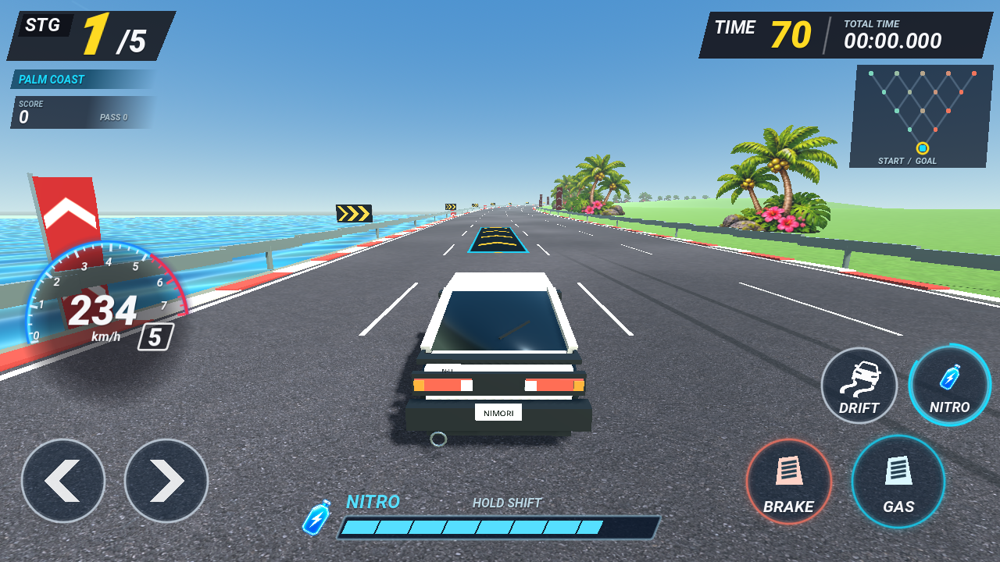
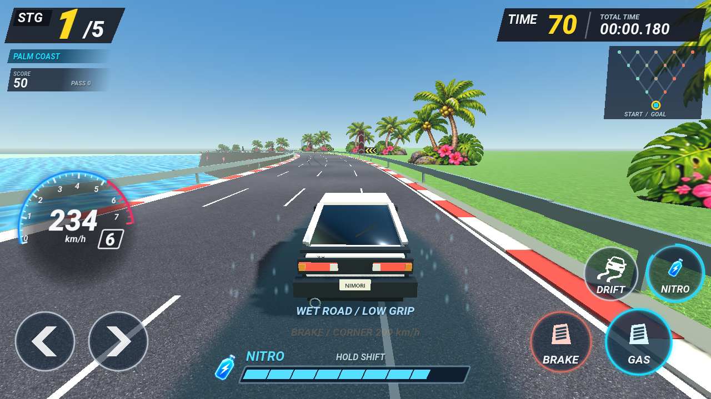

# Occasional road patches

A cyan-framed pad with gold forward chevrons provides 1.2 seconds of automatic acceleration. Pads occupy part of the road and use the selected car's boost tuning, without consuming its gauge or charges. Brake and collision stun cancel the effect. Pads cannot repeatedly activate while parked on them; the Fuji circuit re-arms them once per lap.

Blue-gray puddles have irregular edges and a restrained moving sheen. Entering one briefly slows the car and reduces grip and lateral response. Wet tires retain more sideways momentum; steering response and grip recover over 1.4 seconds after leaving. Only entry triggers a short pooled tire spray. There are no ambient water particles. Reduced-motion mode reduces spray count.

Each Tour stage has two or four patches, totaling fourteen along a complete five-stage tour. Layouts leave entries and forks clear, place pads near gentler road sections, and leave another lane available. Fuji has one pad and one puddle. Rendered geometry and swept tire contact use the same road-space layout; fast movement cannot skip the interaction. CPU lane planning avoids puddles and favors useful pads, while corner and traffic braking override boost.

The pad also triggers existing vehicle-colored exhaust, FOV/speed feedback, a brief HUD cue and an imported launch recording. The puddle displays a short low-grip cue. Collision review removed obsolete 70/88 m/s contact caps that could abruptly slow a car already traveling faster when hit from behind.

`road_feature_checks.gd`, included by `race_test.gd`, covers all fifteen node layouts, fast sweeps, escape lanes, resource independence for all cars, brake/impact cancellation, wet recovery and actual lateral inertia, one spray per entry, per-lap re-arming, CPU activation and high-speed rear impacts. `surface_visual_review.gd` captures actual native-rendered meshes and effects. `tour-metrics.json` and `circuit-metrics.json` record complete scripted drives with patch counters; these are not human or physical-device playtests.

