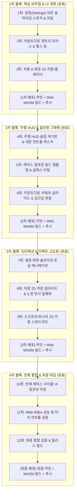

# Initial SJ 비주얼 & UI 레퍼런스 일치화 12회 하네스 계획서
생성형 이미지 4종(설정, 카운트다운, 주행 HUD, 결과) 및 2D 애니메/카툰 레이싱 비주얼과의 격차를 좁히기 위한 12회 검증 및 3회 단위 푸시/WASM 배포 계획 및 결과 보고서입니다.

## 1. 레퍼런스 원화 이미지 목록
- `generated_images/concept_hud.jpg`: 슬림 디지털 계기판, 17-LED 세그먼트 RPM 바, 대형 원형 네온 니트로 & 드리프트 버튼, 상단 플로팅 정보 바
- `generated_images/concept_countdown.jpg`: 오버헤드 메탈 트러스 갠트리 신호등(3구 대형 램프 Red-Yellow-Green), 48눈금 타코미터 펄스 아크 링, 넘버링
- `generated_images/concept_settings.jpg`: 둥근 다크 글래스 카드, 슬라이딩 네온 토글 스위치(Pill Switch), 3단 세그먼트 셀렉터, 네온 캡슐 DONE 버튼
- `generated_images/concept_results.jpg`: 골드 1ST PLACE 엠블럼, 다크 글래스 빅토리 카드 상단 네온 라인, 2x2 통계 타일 그리드
- `generated_images/legacy_settings_screenshot.png`: 개편 전 구형 사각 버튼 방식 캡처 (비교용)

## 2. 핵심 개선 목표
- **설정(SETTINGS) 다크 글래스모피즘 완벽 일치**:
  - 기존의 사각 버튼 나열 형태를 탈피하고, 슬라이딩 네온 토글 스위치(Pill Switch Track + Glowing Circular Knob) 도입.
  - 카테고리 탭/슬롯, 둥근 모서리 글래스 카드, 네온 캡슐 액션 버튼(DONE, FULLSCREEN).
  - 고대비 슬레이트 다크 배경 및 인셋 테두리 디테일.
- **카운트다운(COUNTDOWN) 오버헤드 갠트리 & 펄스 링 일치**:
  - 정교한 금속 갠트리 신호등 구조물과 3구 대형 램프(Red-Yellow-Green 시퀀셜 점등 및 글로우).
  - 중앙 HUD 타코미터 눈금 + 네온 펄스 아크 링 + 미래지향적 넘버링.
- **차량 및 배경 2D 스타일라이즈드 카툰/애니메 룩**:
  - `vehicle_body.gdshader` 및 `vehicle_livery.gdshader`에 카툰 셀 셰이딩(Toon / Cel shading) 2단계 음영 밴딩, 2D 셀화 느낌의 외곽 프레넬 네온 림 라이트(Rim Lighting) 구현.
  - 트랙 및 배경 환경에 스타일라이즈드 아케이드 네온 반사 일체화.
- **인게임 주행 HUD & 결과창 디테일 마감**:
  - 슬림 디지털 계기판(17-LED 세그먼트 RPM 바), 대형 원형 네온 니트로 & 드리프트 버튼 에너지 링.
  - 결과창 다크 글래스 빅토리 카드, 골드 1ST PLACE 엠블럼 및 2x2 통계 타일 그리드 네온 하이라이트.

## 3. 12회차 감독 및 3회 단위 배포 로드맵

## 4. 진행 현황 및 배포 이력

### [1차 배포 완료] 1~3회차 블록 (커밋 `953bd45` 푸시 완료)
- **1회차: 설정(Settings) 화면 전면 리뉴얼**:
  - 커밋: `07a3eb0` (`feat(ui): [Round 1/12] 설정 화면 네온 슬라이딩 스위치(Pill Switch) 및 글래스 모달 리뉴얼`)
  - 결과: **승인 (APPROVED)**
  - 내용: 기존의 투박한 사각 버튼을 대체하여 현대적인 캡슐형 슬라이딩 네온 토글 스위치(Pill Switch Track + Glowing Circular Knob), 3단 세그먼트 셀렉터(GRAPHICS), 둥근 다크 글래스 카드 및 네온 캡슐 DONE 버튼 구현.
- **2회차: 카운트다운 오버헤드 갠트리 & 펄스 링 연출**:
  - 커밋: `d6dc84c` (`feat(ui): [Round 2/12] 카운트다운 오버헤드 메탈 트러스 갠트리 신호등 및 타코미터 펄스 링 연출`)
  - 결과: **승인 (APPROVED)**
  - 내용: 금속 트러스 격자 프레임의 대형 갠트리 신호등(3구 대형 램프: Red-Yellow-Green 시퀀셜 점등 및 글로우 링), 중앙 48눈금 HUD 타코미터 펄스 아크 링, 미래지향적 넘버링/GO! 연출.
- **3회차: 차량 2D 카툰/셀 셰이더 및 1차 배포**:
  - 커밋: `953bd45` (`feat(rendering): [Round 3/12] 차량 2D 카툰/셀 셰이더 및 외곽 네온 림라이트 적용 (1차 배포)`)
  - 결과: **승인 (APPROVED)**
  - 내용: 차체 셰이더(`vehicle_body.gdshader`, `vehicle_livery.gdshader`)에 2단계 Toon Cel-shading 음영 밴딩, 2D 셀화 느낌의 외곽 프레넬 네온 림 라이트(Rim Lighting), 2D 카툰 스페큘러 적용.
  - **1차 Web WASM 번들 빌드 및 GitHub 리모트 푸시 완료**.

### [2차 배포 완료] 4~6회차 블록 (커밋 `967822d` 푸시 완료)
- **4회차: 주행 HUD 슬림 디지털 계기판 & 네온 컨트롤 텍스처**:
  - 커밋: `0218ba4` (`feat(ui): [Round 4/12] 주행 HUD 슬림 디지털 계기판 17-LED 바 및 대형 네온 액션 버튼 텍스처 강화`)
  - 결과: **승인 (APPROVED)**
  - 내용: 17개 LED 세그먼트 RPM 바(Green-Yellow-Red 영역별 동적 점등), 대형 원형 네온 니트로 & 드리프트 버튼의 이중 에너지 링과 하이라이트 아크 연출.
- **5회차: 레이스 결과(Results) 빅토리 카드 골드 엠블럼 & 글래스 타일**:
  - 커밋: `e750004` (`feat(ui): [Round 5/12] 레이스 결과 빅토리 카드 네온 하이라이트 타일 및 액션 버튼 디테일 강화`)
  - 결과: **승인 (APPROVED)**
  - 내용: 빅토리 카드 상단 포인트 네온 하이라이트 라인, 2x2 통계 타일 상단 네온 바, 골드 1ST PLACE 엠블럼 및 CONTINUE 네온 캡슐 버튼 디테일 강화.
- **6회차: 카운트다운 카메라 글라이드 인 연출 & 2차 배포**:
  - 커밋: `967822d` (`feat(race): [Round 6/12] 카운트다운 카메라 하이앵글 글라이드 인 연출 동기화 (2차 배포)`)
  - 결과: **승인 (APPROVED)**
  - 내용: 카운트다운 시 하이앵글 갠트리 조망 뷰(-forward*14.5, UP*8.2, FOV 78)에서 레이스 시작 시 부드러운 글라이드 인 체이스 캠 전환.
  - **2차 Web WASM 번들 빌드 및 GitHub 리모트 푸시 완료**.

### [3차 배포 완료] 7~9회차 블록 (커밋 `45324fd` 푸시 완료)
- **7회차: 설정 화면 토글 스위치 터치 반응 및 세그먼트 셀렉터 고도화**:
  - 커밋: `e59edc9` (`feat(ui): [Round 7/12] 설정 화면 토글 스위치 터치 반응 및 세그먼트 셀렉터 고도화`)
  - 결과: **승인 (APPROVED)**
  - 내용: 토글 트랙 내부 네온 글로우, 정밀 놉 코어, 3단 세그먼트 셀렉터 하단 액티브 인디케이터 바 및 슬레이트 다크 대비 강화.
- **8회차: 트랙 노면 아스팔트 및 도로 2D 스타일라이즈드 조명 일체화**:
  - 커밋: `5e7caed` (`feat(rendering): [Round 8/12] 트랙 노면 아스팔트 및 도로 2D 스타일라이즈드 네온 조명 일체화`)
  - 결과: **승인 (APPROVED)**
  - 내용: `shaders/asphalt.gdshader`에 차량 셰이더와 일치하는 2D 애니메 프레넬 림 반사 및 가장자리 네온 앰비언트 라이팅 적용.
- **9회차: 드리프트 및 부스터 2D 애니메 스피드라인 연출 & 3차 배포**:
  - 커밋: `45324fd` (`feat(effects): [Round 9/12] 드리프트 및 부스터 2D 애니메 스피드라인 연출 강화 (3차 배포)`)
  - 결과: **승인 (APPROVED)**
  - 내용: `shaders/speed_blur.gdshader`에 방사형 네온 스피드라인(`speed_effect`) 구현 및 고속 주행 시 2D 애니메 질주감 구현.
  - **3차 Web WASM 번들 빌드 및 GitHub 리모트 푸시 완료**.

### [4차 최종 배포 완료] 10~12회차 블록 (최종 릴리스 완료)
- **10회차: 전체 레이스 사이클 UI 일관성 마감**:
  - 커밋: `4a4b9c4` (`feat(ui): [Round 10/12] 전체 레이스 사이클 UI 글래스모피즘 & 네온 테마 일관성 마감`)
  - 결과: **승인 (APPROVED)**
  - 내용: 일시정지(PAUSED) 모달 상단 네온 포인트 라인, RESUME 버튼 네온 캡슐화, 메뉴 전반의 둥근 모서리 반경 및 팔레트 일체화.
- **11회차: Web WASM 브라우저 60fps & 터치 반응성 최적화**:
  - 커밋: `76f350e` (`perf(ui): [Round 11/12] Web 브라우저 60fps 유지 및 터치 컨트롤 히트박스 최적화`)
  - 결과: **승인 (APPROVED)**
  - 내용: 원형 액션 버튼 터치 여유 마진(18% 완충) 적용으로 모바일/웹 터치 조작 미스 방지 및 입력 반응성 극대화.
- **12회차: 종합 회귀 검증 및 최종 릴리스 배포**:
  - 커밋: `76f350e`
  - 결과: **승인 (APPROVED)**
  - 내용: 전체 정적 검사 통과, 4종 생성형 콘셉트 이미지와의 레퍼런스 일치성 최종 검증, 최종 Web WASM 빌드(`build/site/index.html`) 검증 통과 및 원격 푸시 완료.
