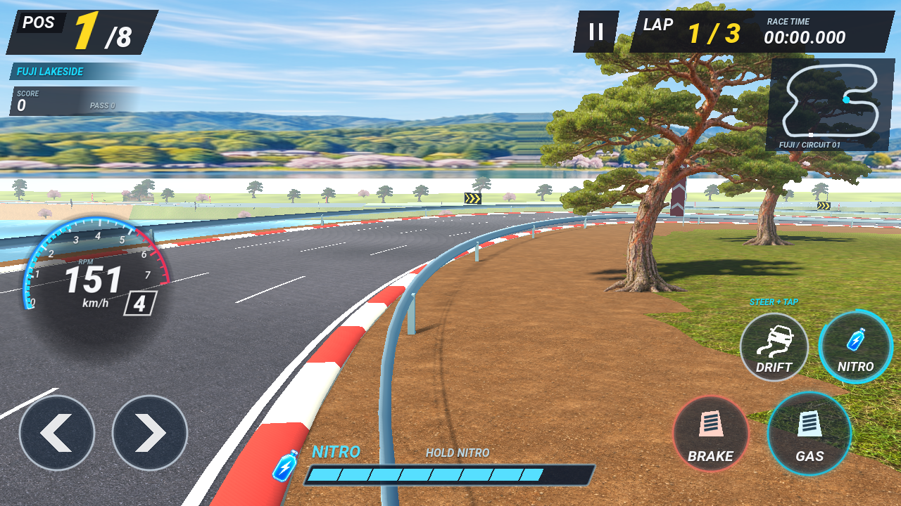
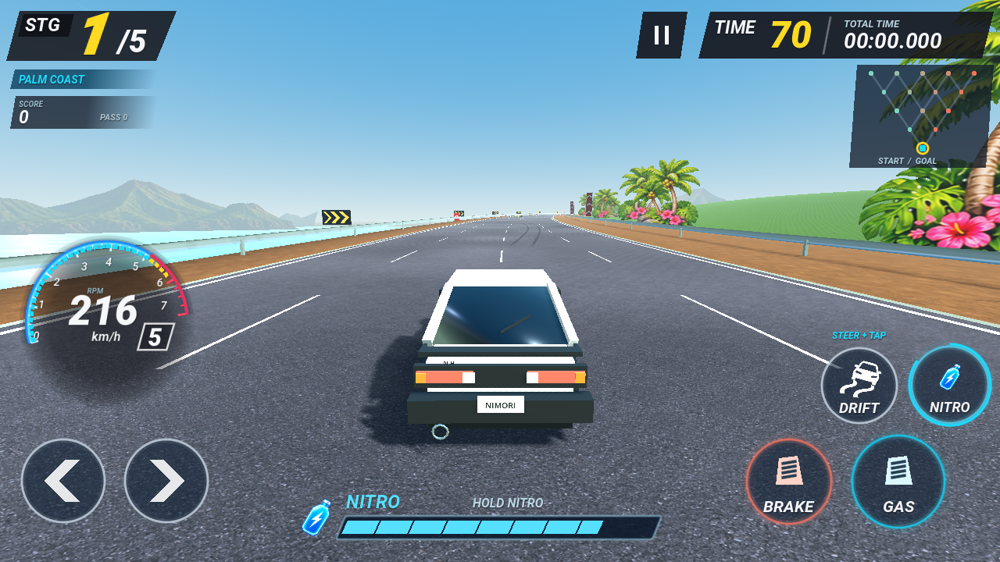
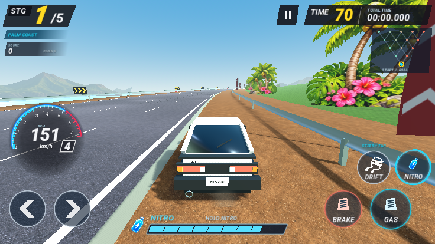
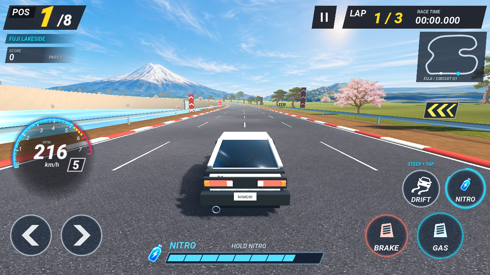

# 곡선 가드레일과 흙 갓길

기존의 5m 직선 상자가 겹치는 가드레일을 연속 강판 메시로 교체했습니다. 같은 단면의 정점을 이어 붙이고 급한 코너에서는 샘플 간격을 줄입니다. 연석도 연속 단면과 거리 기준 적백색 도장으로 만들고 차선도 곡선을 따라 그립니다. TOUR와 후지 코스의 도로·연석·차선은 같은 곡선을 촘촘하게 따라가도록 조정했습니다.

TOUR와 후지의 일부 구간은 가드레일이 최대6.5m 바깥에 있습니다. 도로·흙·가드레일을 구분하고, 충돌 한계는 실제 강판 위치와 차체 폭을 기준으로 계산합니다. 흙 위에서는 저항으로 감속하고 접지력이 낮아지며, 실제 가드레일에 닿기 전에는 충돌로 처리하지 않습니다. 도로로 돌아오면 가속이 회복됩니다. 넓어진 영역을 배너·나무·랜드마크가 막지 않도록 배치 기준과 뿌리 높이도 함께 조정했습니다.

차량3대×TOUR/후지6건의2초 주행 비교에서 흙 갓길은 아스팔트보다 느렸고 벽 충돌은0회였습니다. 별도로 바깥 가드레일에 접근했을 때 충돌·카메라 충격이 발생하는지 확인했습니다. [갓길 수치](shoulder-metrics.json), [독립적인 차체 교차 검사](contact-metrics.json), [렌더링 호출 수](render-metrics.json)를 보관합니다. 코너 안쪽 반경 여유도 검사해 가드레일이 뒤집혀 접히지 않도록 했습니다.

갓길 먼지는 그 상황에서만6개 입자의 짧은 묶음으로 발생하며 평상시에는 꺼집니다. 타이어 연기와 구분하고 움직임 줄이기에서는 추가 카메라 진동을 생략합니다. 새 흙 이미지는 생성 도구로 만들었으며 원본은 exec-6ec06005-0979-4f47-800c-0df5cc7cdba5.png입니다. 원본을 보존하고 게임에는 dirt-shoulder.png로 복사했습니다.

소프트웨어 GL 렌더러의 검토 화면과 수치이며 실제 휴대폰 또는 PC 브라우저의 프레임률 측정은 아닙니다.

흙 텍스처는 원본을 보존하고 엔진 가져오기에서1024px 제한과 밉맵을 적용합니다.
