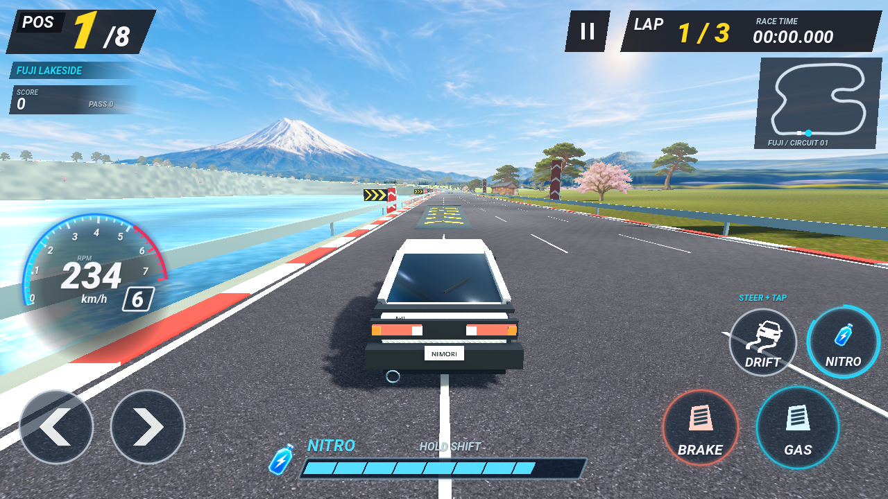
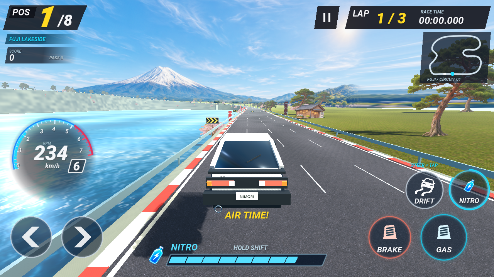
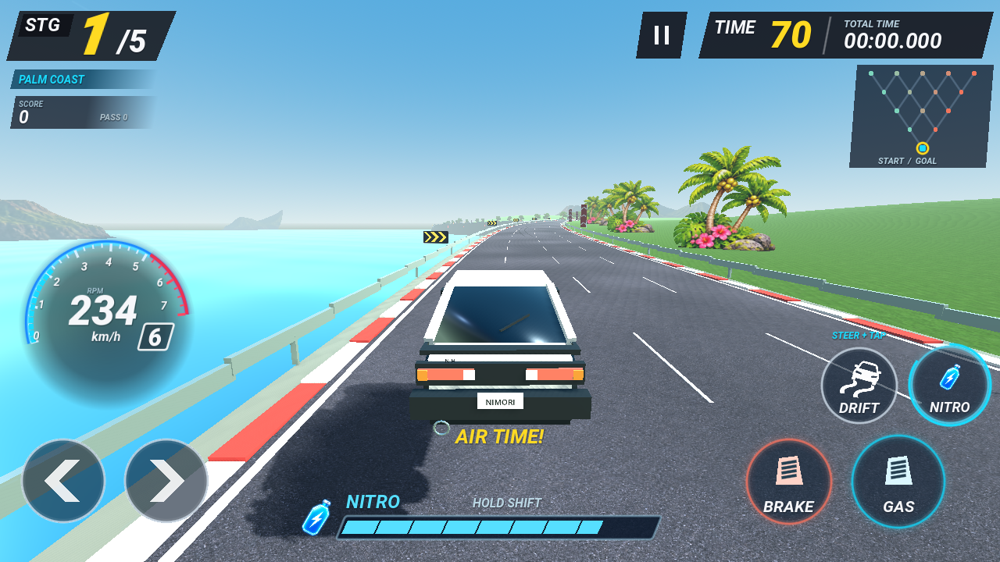
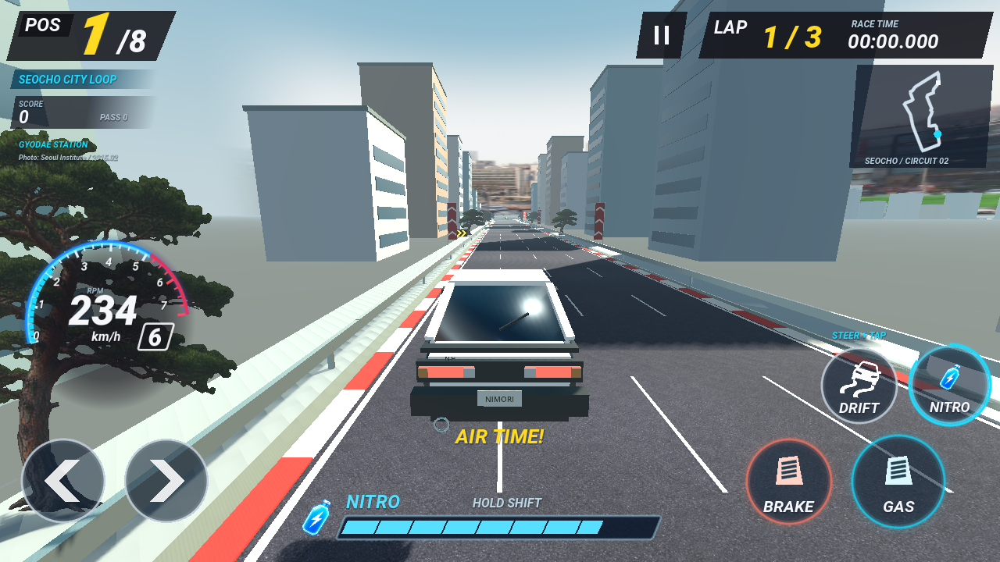
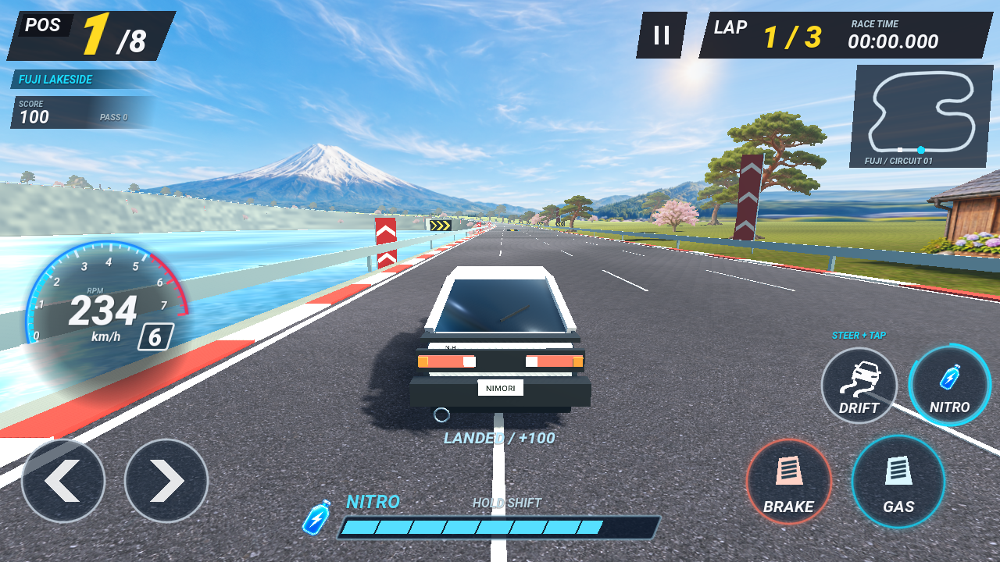
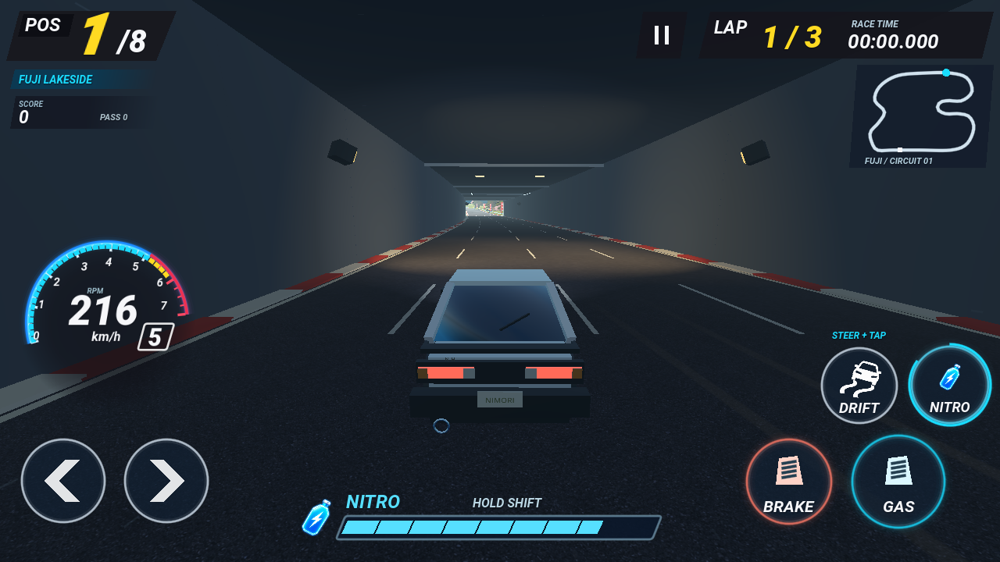
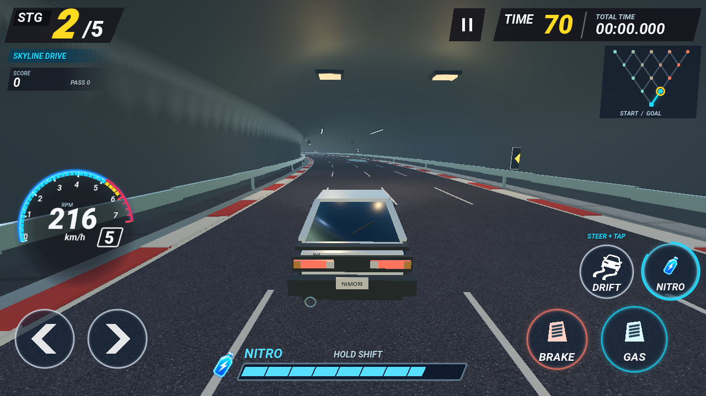

# 점프·착지와 터널 조명 검토

공중 높이는 원래 도로의 높이와 분리한 실제 월드 좌표로 계산합니다. 올라가는 도로와 만나면 더 일찍 착지하고, 같은 랩의 같은 점프대에서 중복 발사하지 않습니다. 정지·느린 주행으로 경사로를 내려올 때에는 위로 튀는 힘을 넣지 않습니다.

- TOUR·두 TRACK에서1/120초·1/30초·0.2초 간격의 빠른 통과를 검사했습니다. 각 통과는 점프1회·착지1회이고, 반대 차선으로 피해 갈 수 있습니다. [점프 수치](jump-metrics.json)
- 실제 레이스의 공중 차량이 아래 차와 충돌하지 않는지, 착지 후 지상 충돌은 유지되는지 검사했습니다.
- 점프대를 추가한 두 코스에서 세 차량 모두3랩을 완주했습니다. 후지산의 벽 접촉은 세 차량 모두0회, 서초는0·0·2회였습니다. CPU는 회로에서 재생성하지 않습니다. [후지 주행](circuit-metrics.json), [서초 주행](seocho-drive-metrics.json)
- 착지음은 기존 WAV 파일의 재생이며 낮은 음높이와 작은 음량을 사용합니다. 실제 네이티브 믹서 녹음에서 피크0.184미만·클리핑0회·음소거 후 RMS0을 확인했습니다. 브라우저의 연속 OGG 루프는 기존 독립 재생 방식을 유지합니다. [오디오 수치](jump-audio-metrics.json)

천장등은 따뜻한 색의 Omni, 선형등은 파란 Omni, 작업등은 도로를 향하는 Spot입니다. 실제 도로·차체에 색이 비치며 최대6개의 가까운 조명만 켭니다. 두 모드의 터널에서 세 종류와 조명 수 제한을 검사했습니다. 이 문서의 화면은 네이티브 GL Compatibility 렌더이며 실제 모바일 성능 수치를 뜻하지 않습니다.
