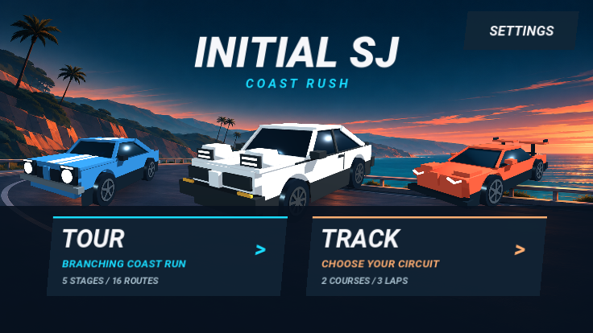
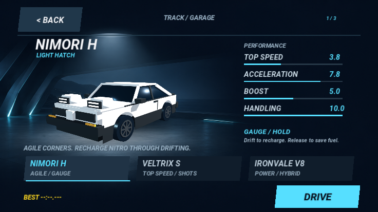
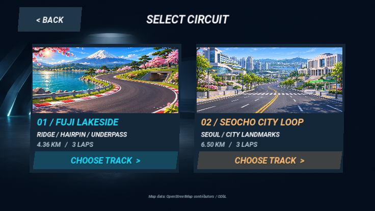
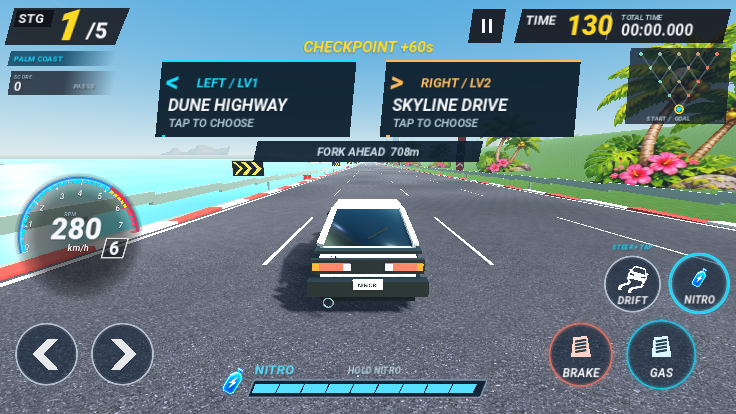
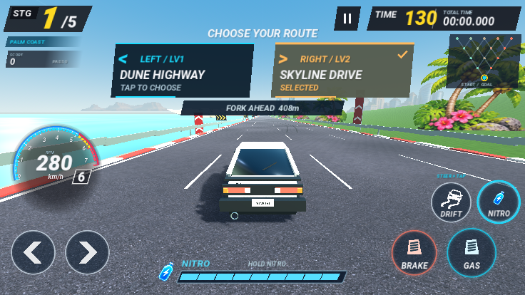
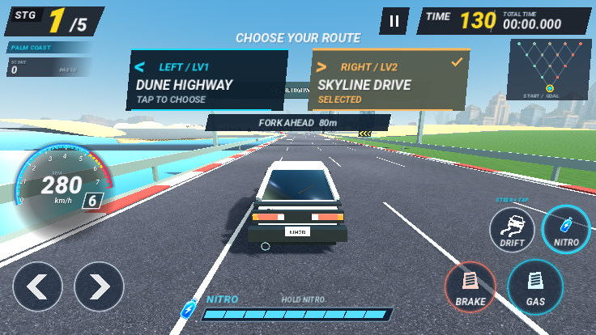
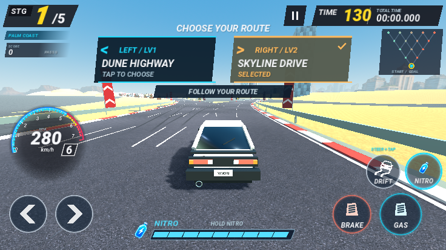

# 모바일 화면과 TOUR 갈림길 검토

생성형 해안·차고 배경과 후지·서초 코스 이미지를 적용했습니다. 차량은 선택 화면·메인·레이스에서 동일한 게임 모델을 사용합니다. 버튼·성능 정보·코스 이름은 이미지에 구워 넣지 않고 실제 UI로 그리므로 선명도와 터치 영역을 유지합니다. 실제 414px 높이 가로 창에서 가독성·겹침을 검토했고, 코스 선택 제목이 BACK에 겹치던 문제를 수정했습니다. 원경만 보이던 코스 사진형 카드는 도로 형태와 랜드마크가 읽히는 생성형 그림으로 교체했습니다.

체크포인트와 분기 지점을 분리했습니다. 보상 후 720m를 직진하며 다음 테마·난이도·선택 상태를 큰 터치 카드로 확인합니다. 최고 부스트114m/s와 게임 템포1.2배에서도 실제 갈림길까지5.26초 이상입니다. 보통 주행에서는 이보다 오래 안내됩니다. 도로 화살표와 거리 안내를 추가하고 밝은 하늘에 묻히던 거리 글자는 어두운 배경 위로 옮겼습니다.

카드를 터치하면 갈림길 가까이에서 선택한 쪽으로 차선 안내를 돕습니다. 실제 차를 움직여 물리적인 길을 타며, 강제 위치 이동이나 좌우 순간 이동은 없습니다. 직접 조향하면 수동 입력이 즉시 우선합니다. 체크포인트 시간·니트로 보상은 직선 시작에서 한 번만 지급합니다. 갈림길을 바꿔도 완료한 체크포인트 보상을 다시 받지 않습니다.

`fork_checks.gd`는 10개 분기 전 구간의 직선 곡률, 최고속에서도5초 확보, 터치 선택6건(차량3대×좌우), 벽 충돌·위치 연속성, 수동 조향 우선, 중복 보상 방지를 검사합니다. [수치](fork-metrics.json)를 함께 보관합니다. 전체 주행 규칙과 화면 전환 검사도 통과했습니다. 새 도로에 대한 차량3대·좌우·혼합 주행 검토는 [전체 TOUR 결과](tour-metrics.json)에 기록합니다. 가속만 유지한 주행은 실패하고, 브레이크·드리프트를 사용하는5개 시나리오는 모두 완주했습니다.

TOUR 형상이 바뀌어 새 기록 키를 사용합니다. TRACK 기록과 예전 저장 파일은 유지합니다. 이 검토는 네이티브 GL 그래픽 화면과 입력 자동화이며, 실제 휴대폰 브라우저의 프레임률을 측정한 결과는 아닙니다.
