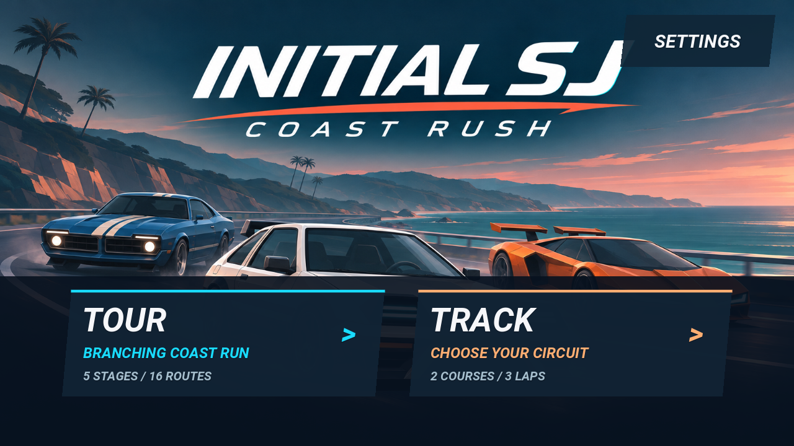
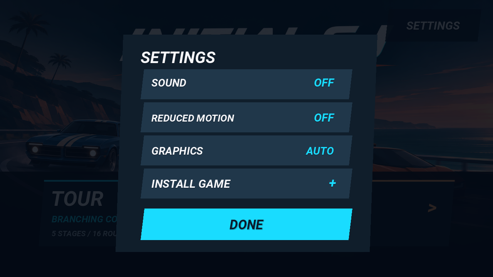
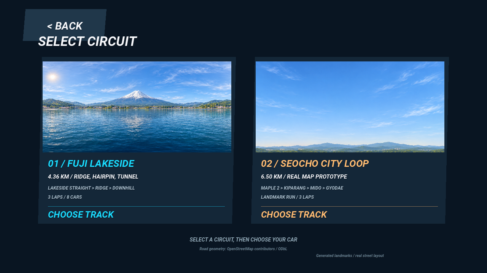
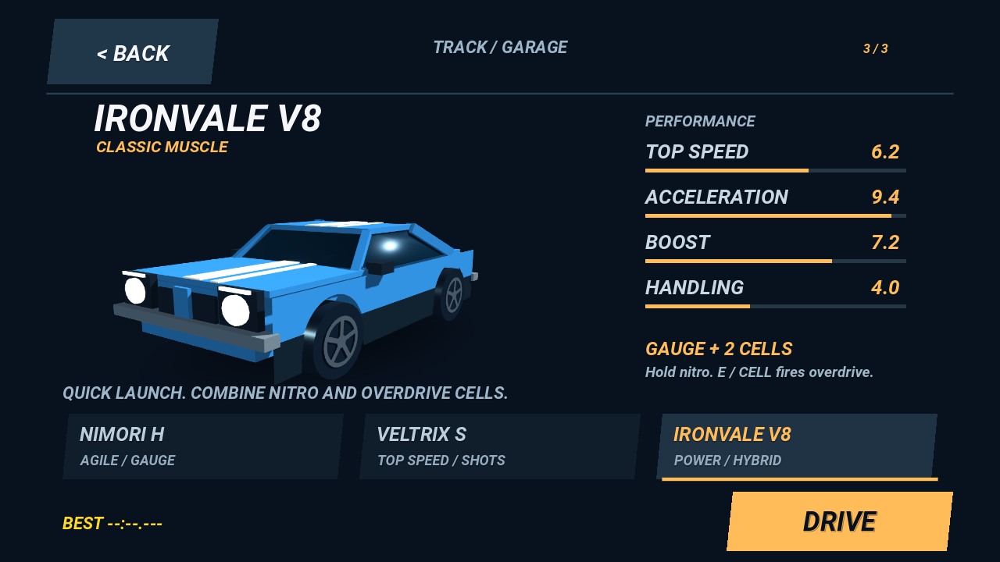
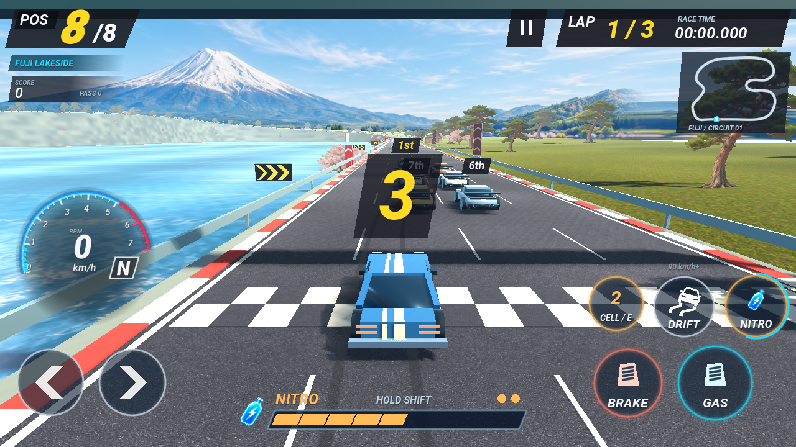
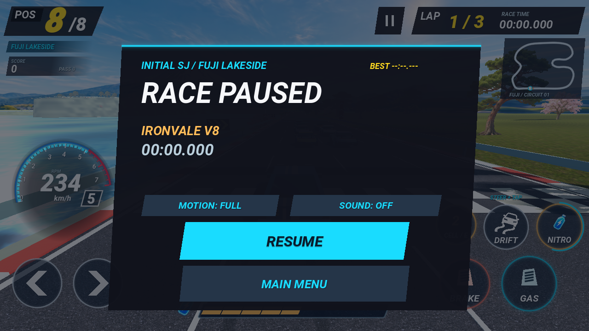
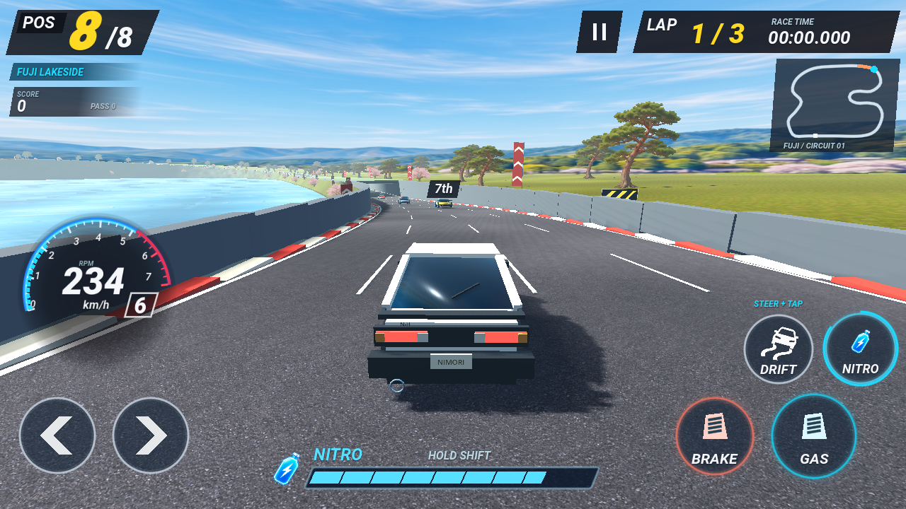
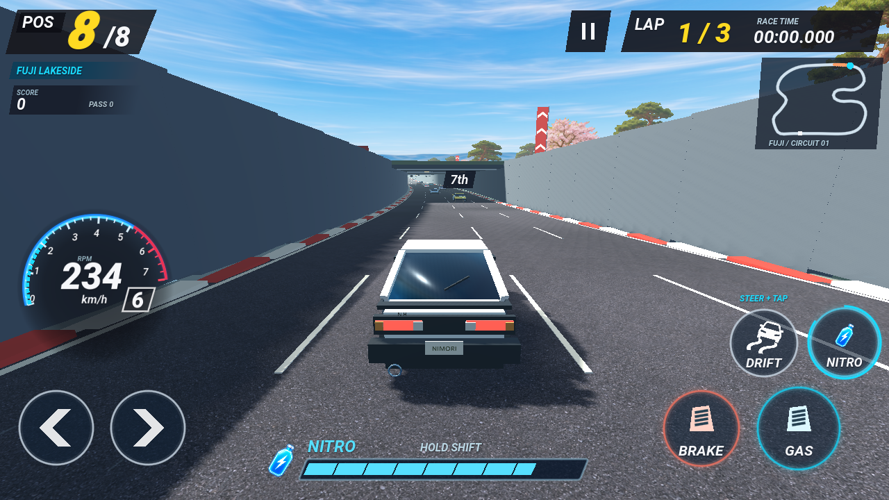

# 화면 흐름 · 가독성 · 웹 렌더링 검토

메인 → TOUR 또는 TRACK 코스 선택 → 차량 선택 → 카운트다운 → 레이스를 짧은 페이드와 슬라이드로 연결합니다. 차량을 바꾸면 동일한 인게임 모델 이미지가 크로스페이드하고 성능 막대가 보간됩니다. DRIVE는 출발 카메라에서 카운트다운으로 이어집니다. 움직임 줄이기에서는 슬라이드·출발 카메라 이동을 생략합니다.

정지 화면의 보조 버튼은 MAIN MENU이며 TOUR·TRACK 선택 화면으로 돌아갑니다.

주요 터치 영역은 896×414 가로 화면에서 최소44px 높이입니다. 메인·설정·차량 선택의 키 안내를 정리하고 DONE만 남겼습니다. 전환 중 중복 터치 방지, 종료 후 UI 위치·투명도 복원, 코스 재사용, 터치 선택, 움직임 줄이기는 `transition_review.gd`로 실제 그래픽 화면에서 확인했습니다. 키보드 주행·브레이크·드리프트·니트로·하이브리드 셀 입력도 통과했습니다.

설치 브리지는 설치 이벤트 수신·수락·설치된 상태·iOS/Mac Safari/Firefox 안내·중복 준비 방지를 Node DOM 대역으로 검증했습니다. 웹 export 결과의 manifest는 `standalone`, `landscape`, 상대 경로 시작 주소이며, 아이콘·서비스 워커가 `/initialsj/` 안에 생성됩니다. 실제 브라우저의 설치 승인은 이 환경에서 자동 조작하지 않았습니다.

정적 계기판 캐시, 단일 메시 RPM 막대, 멀리 있는 차량의 효과 갱신 생략, 물리 보간을 적용했습니다. AUTO는 웹에서 중간 품질로 시작하며 지속적인 프레임 지연이 감지되면 그림자 범위·3D 해상도·화면 블러를 줄입니다. HIGH/FAST 수동 선택도 제공합니다. UI 해상도는 유지합니다. [렌더링 호출 수](render-metrics.json)는 동일한 1280×720 시작 장면의 HIGH/FAST 비교이며, 소프트웨어 렌더러에서 측정한 실제 사용자 PC 프레임률 주장이 아닙니다.

후지·서초 각각 차량3대의3랩 완주 검증에서 벽 충돌0회였으며, 점프·공중 충돌 분리·착지·터널 조명·자동 품질 회귀 검사도 통과했습니다. 착지 파일 효과음은 클리핑0프레임, 음소거 뒤 RMS0입니다.

## 후지 지하차도

터널 앞뒤 약190m에 걸쳐 도로를 약6.5m 파내고 옹벽과 지표 덮개를 연결했습니다. 입구 앞 실제 하강과 출구 뒤 상승을 수치와 게임 화면으로 확인했습니다.
