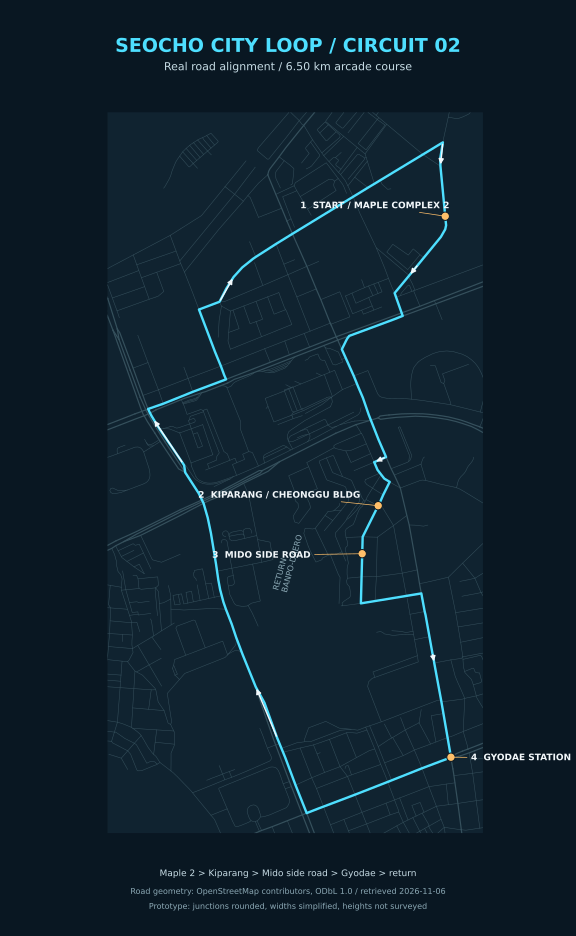

# 서초 시티 루프 — 트랙 02 지도 시안

메이플자이 2단지 옆 **나루터로4길**에서 출발해 신반포로33길·잠원로·서초중앙로·고무래로를 거쳐 **고무래로10길10 청구빌딩의 기파랑문해원**으로 향합니다. 이후 **고무래로10길의 미도아파트 동쪽 옆길**, **서초중앙로29길**, **서초중앙로**, **교대역 교차로**를 지납니다.

복귀 구간은 우선 서초대로 → 반포대로 → 신반포로 → 잠원로3길·4길 → 나루터로4길로 잡았습니다. 사용자가 지정한 경유지를 순서대로 연결하고, 동일한 도로를 왕복해 겹치는 구간을 피한 시안입니다. 확정된 실제 내비게이션 경로를 뜻하지 않습니다.

- 출발 단지: [메이플자이 2단지, 신반포로253](https://juso.app/b/59pmsda6w7f902yb). 사유지 내부 대신 단지 옆 공공 도로에 출발선을 배치했습니다.
- 학원: [공식 오시는 길](https://banpo.kiparang.co.kr/new_prog/map.aspx)의 현재 1관 주소인 **고무래로10길10, 청구빌딩6층**을 사용합니다. 공식 페이지의 좌표는 위도37.5018943, 경도127.0104840입니다. 다른 관을 뜻했다면 해당 경유지만 조정할 수 있습니다.
- 미도 옆길: OSM의 고무래로10길 way185582677 및 서초중앙로29길 way185582682.
- 교대역: 서초중앙로·서초대로 교차로를 경유합니다.
- 원본 도로 형상: [OpenStreetMap](https://www.openstreetmap.org/#map=16/37.503/127.010), © OpenStreetMap contributors, [ODbL1.0](https://www.openstreetmap.org/copyright). 2026-11-06 공개 Overpass 데이터 조회. 사용한 원본 좌표·도로 ID와 단순화한 좌표는 [seocho-osm-route.json](../data/seocho-osm-route.json)에 함께 보관합니다.

실제 도로 좌표를 미터 단위로 변환했습니다. 게임 코스는 약 **6.50km**이며, 교차로는 최대35m 범위에서 둥글게 하고 좁은 옆길과 대로의 폭을 구분했습니다. 건물 배치·도로 폭·고도는 정밀 실측 재현이 아닌 게임용 시안입니다. 실제 신호·일방통행 규칙을 재현하는 내비게이션이 아니라 차량8대가 달리는 폐쇄형3랩 레이스입니다. 후지 코스와 차량별 기록을 별도로 저장합니다.

## 생성형 배경과 랜드마크

실사 원본은 게임에서 제거했습니다. 사진에서 건축 형태와 색감을 참고해 새로 생성한 투명 이미지 두 장으로 주요 건물 10개만 배치합니다. 반복 상가·아파트를 일렬로 깔던 배경도 제거했습니다. 병원·법원·터미널은 도로 바로 옆으로 옮기지 않고 실제 위치 방향의 원경 랜드마크로 둡니다. 가까운 건물만 차도 침범을 피하도록 최소한으로 이동하며 이동량은 검증 데이터에 남깁니다.

- 메이플자이2단지, 반포미도, 반포역 상가, 청구빌딩, 교대역 입구, 서초역 입구
- 서울성모병원, 서울법원종합청사, 고속버스터미널, 서초중앙로239의 반포그린 주유소를 참고한 무상표 주유소
- 생성형 서울 원경 하늘: 후지산·바다·현장 사진 투영을 사용하지 않습니다.

이전 사진의 연구 출처는 [참고 사진 목록](../data/seocho-photo-sources.json)에 보존했습니다. 추가 건축 참고: [성모병원 공식 위치](https://www.cmcseoul.or.kr/hospitalguide.map.sp), [법원 조직·위치](https://www.scourt.go.kr/eng/judiciary/organization/courts3.jsp). 사용자가 제공한 [네이버 로드뷰 링크](https://map.naver.com/p?c=15.47,0,0,2,adh&p=ZwUKbsdghfiHwalyDapVFA,-94.48,10,80,Float)는 이 실행 환경에서 장면을 직접 열람하지 못했습니다.

## 높낮이

[OpenTopoData SRTM90m](https://www.opentopodata.org/datasets/srtm/)에서 경로 주변 58개 표고를 조회했습니다. [원시값과 완화한 표고](../data/seocho-elevation.json)를 보존하고, 약16~46m의 표고를 부드럽게 연결해 실제 3D 도로와 지면에 적용합니다. 건물·교량 영향을 포함할 수 있는 90m급 지형 자료이므로 차선 단위 실측 높이의 재현은 아닙니다. 서초역 쪽 오르막과 반포 방향의 낮아지는 지형을 먼저 살린 시안입니다.
