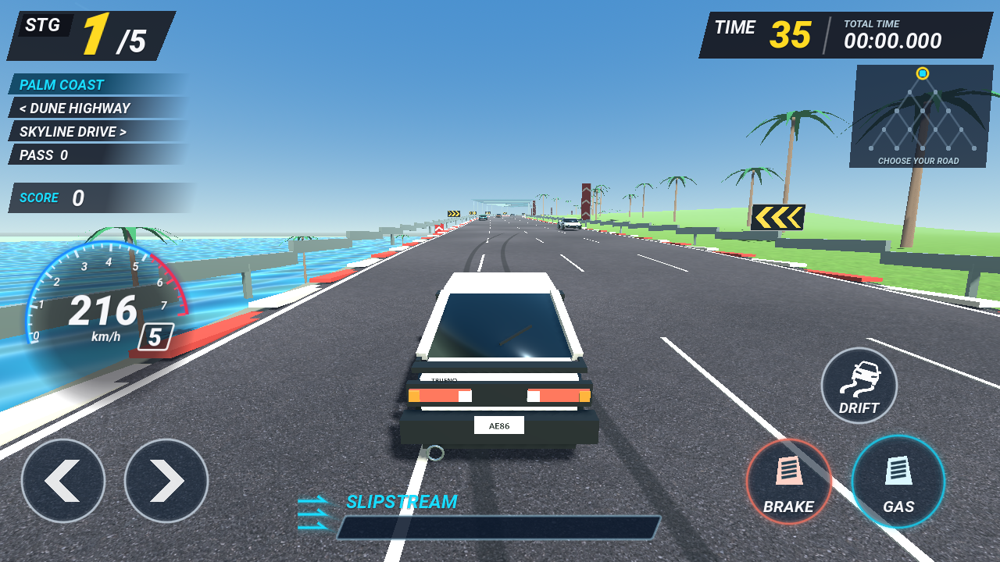

# Initial SJ — Coast Rush

OutRun 2006을 참고한 **3D 오픈 로드 아케이드 투어**입니다. 한 바퀴를 반복하는 경주 대신 제한 시간 안에 체크포인트를 통과하고, 좌우 갈림길로 다음 목적지를 선택합니다. 5구간을 달리며 8가지 배경을 만납니다.

[웹에서 플레이](https://obmaz.github.io/initialsj/new/) · [구현과 검증](docs/TOUR.md) · [레퍼런스 자료](docs/OUTRUN_REFERENCE.md)

플레이어 차량은 흰색·검정 투톤의 **AE86 Trueno 3도어 해치백 스타일**입니다. 팝업 헤드라이트, 작은 리어 스포일러와 8스포크 휠을 직접 만든 3D 메시로 구현했습니다.



## 조작

| 입력 | 동작 |
| --- | --- |
| Enter | 시작 / 다시 시작 |
| W / ↑ | 가속 페달 |
| Shift / 화면 NITRO | 니트로 가속. 터치에서는 가속 페달 역할도 함께 수행 |
| S / ↓ | 브레이크. 가속과 함께 누르면 브레이크 우선 |
| A, D / ←, → | 조향 |
| 브레이크 짧게 누르기 + 조향 → 가속 | 약 90 km/h 이상에서 드리프트 시작 |
| Space + 조향 / 화면 DRIFT | 드리프트 시작 단축 조작 |
| P / Esc / TIME 패널 | 일시정지·재개 |
| R | 투어 초기화 |
| M / V | 화면 움직임 완화 / 소리 켜기·끄기 |
| 화면 GAS / BRAKE / DRIFT / 화살표 | 모바일 멀티터치 조작 |

가속 페달을 계속 눌러 주행합니다. 드리프트 중에는 진입 속도를 유지하며 방향을 조절합니다. 직선에서 조향을 풀어 차를 바로 세우면 드리프트가 끝납니다. 앞차 뒤를 가까이 따라가면 슬립스트림을 얻습니다. 니트로는 별도 버튼 또는 Shift로 사용합니다. 연료는 드리프트·근접 추월·체크포인트와 일반 주행으로 회복됩니다. 브레이크와 드리프트 중에는 니트로가 꺼집니다.

시작 제한 시간은 70초이며, 체크포인트마다 경로에 따라 52~60초를 받습니다. 5구간 완주 또는 시간 초과로 종료하며, 최고 완주 시간은 `user://records.cfg`의 `coast_rush_v2` 항목에 저장합니다. 이전 짧은 코스의 기록은 보존하며 새 긴 코스와 분리합니다.

## 배경과 효과

- 하와이, 사막, 도시, 놀이공원, 폐허 도시, 피라미드, 제주, 서울 테마
- 약 16.7~18.3 km의 실제 3D 도로, 변화하는 도로 폭과 고저차, 물리적으로 갈라지는 분기
- 오른쪽을 고를수록 길어지는 거리, 좁아지는 폭, 강해지는 코너·교통량·시간 압박
- 6종 건물 형태와 외벽 재질, 가로수·관람차·풍력 발전기·탑
- 일부 구간의 짧은 반투명 유리 캐노피, 최장 1.1 km의 연속 터널과 헤드라이트, 생성형 아스팔트·지면 텍스처
- 충돌 불꽃·차체 반동·화면 충격·감속·녹음된 충돌음
- 고속 FOV 변화·카메라 진동·주변부 블러·속도선·충돌·드리프트·체크포인트 상황의 파티클
- 드리프트 타이어 연기·타이어 자국·브레이크등, 경로에 따라 교통 차량 8~16대의 차선·간격·코너 판단
- 속도계는 왼쪽, 오른쪽 아래에는 가속·브레이크, 위에는 드리프트·니트로 조작부

현재 배경과 차량은 스타일화한 프로토타입입니다. 실제 지역의 지리나 OutRun 원본 코스를 복제하지 않았습니다. 거리·차선 오프셋으로 주행을 계산하며 `VehicleBody3D` 타이어 시뮬레이션은 사용하지 않습니다. 생성형 후지산 파노라마를 사용하던 이전 배경 원본은 보존했지만 현재 투어의 원경으로 사용하지 않습니다.

## 실행과 검증

```sh
godot --path new
godot --headless --path new --editor --import --quit
godot --headless --path new --script res://tests/race_test.gd
godot --headless --path new --script res://tests/contact_review.gd
godot --headless --path new --script res://tests/tour_review.gd
```

요청 목표 버전은 Godot **4.7.2**, 현재 설치되어 실행·내보내기를 검증한 버전은 **4.6.3 stable / GL Compatibility**입니다. 4.7.2 실행 검증은 하지 않았습니다. 웹은 단일 스레드로 내보내 GitHub Pages에서 실행합니다. 실제 모바일 기기의 성능과 터치 감도는 별도 실기기 검증이 필요합니다.

오디오는 엔진·타이어 **OGG 녹음 루프**와 충돌·안내 **WAV 파일**입니다. 웹의 연속 루프는 브라우저 AudioBufferSourceNode의 자체 반복을 사용해 렌더링 지연에 따른 루프 끊김을 피합니다. [음원 출처와 라이선스](assets/audio/LICENSE.txt): 엔진 qubodup, 타이어 audible-edge(Tom Haigh), 루프 편집 qubodup, CC BY 3.0.

`legacy/`는 변경하지 않습니다. 저장소 루트에서 이전 버전과 새 버전을 선택할 수 있습니다.
