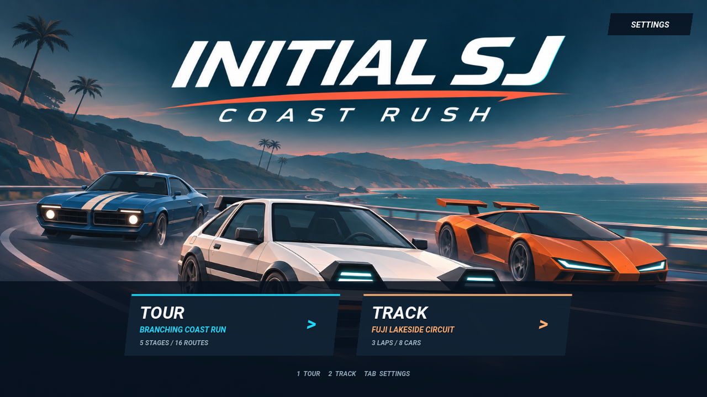
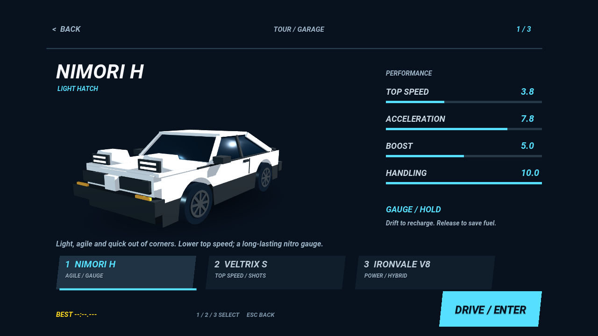

# Initial SJ — Coast Rush

**TOUR / TRACK 두 모드의 3D 아케이드 레이싱 게임**입니다. TOUR는 OutRun 2006을 참고한 분기형 오픈 로드로, 제한 시간 안에 체크포인트를 통과하며 15개 테마 중 5개를 방문합니다. TRACK은 초기 후지산 호수 코스를 복원한 순환 레이스 한 개로, 플레이어를 포함한 8대가 3랩을 달립니다. 시작 메뉴에서 모드와 설정을 선택한 뒤 차량 선택으로 이어집니다.

[웹에서 플레이](https://obmaz.github.io/initialsj/new/) · [모드·차량 구성](docs/MODES.md) · [부스터 패드·물웅덩이](docs/ROAD_FEATURES.md) · [구현과 검증](docs/TOUR.md) · [P2/P3 코드 리뷰](docs/CODE_REVIEW.md) · [레퍼런스 자료](docs/OUTRUN_REFERENCE.md)

차량 선택은 한 대를 크게 보여주는 쇼룸과 성능 패널, 하단의 차량 탭으로 구성합니다. 쇼룸과 주행 차량은 `vehicle_factory.gd`에서 **동일한 3D 모델·재질**을 생성합니다. 제품 내 차량명과 배지는 가상의 이름을 사용합니다. 차량 능력치는 **최고속도·가속도·부스트·핸들링** 네 가지이며, 모든 차량에 동일한 기준의 10점 막대로 표시합니다. 부스트 능력치는 니트로 가속 성능을 나타내고, 게이지·횟수·하이브리드 방식은 별도로 표시합니다. 충돌 감속은 공통이며 방어력 능력치는 없습니다.

| 차량 | 주행 성격 | 니트로 |
| --- | --- | --- |
| NIMORI H | 흰색 해치백, 빠른 조향과 넉넉한 드리프트 그립 | Shift를 누르는 동안 게이지 소비, 드리프트로 회복 |
| VELTRIX S | 낮고 각진 스포츠카, 높은 최고속도 | Shift를 한 번 눌러 2.4초 사용, 3회 보유 |
| IRONVALE V8 | 클래식 머슬카, 강한 가속, 무거운 조향 | Shift 게이지 + E로 1.6초 오버드라이브, 셀 2개 |

횟수형 니트로와 셀은 체크포인트에서 1개씩 회복합니다. 청록·보라·주황 배기 효과와 전용 게이지·횟수 표시로 구분합니다. 선택 화면에서 실제 차량 모델과 능력치를 비교할 수 있고, 최고 기록은 차량별로 따로 저장합니다.

첫 로딩에는 세 차량과 해안 도로를 낮고 긴 차체 비율과 절제된 색감으로 그린 **세련된 모바일 아케이드풍 생성형 일러스트**를 사용합니다. 차량은 실제 제조사 로고 없이 각 장르의 인상만 참고하고, 램프·그릴·스트라이프·스포일러를 별도로 디자인했습니다. 웹 다운로드 화면과 엔진 시작 화면의 이미지를 통일하고, 진행률·시작 준비 상태를 표시합니다. [로딩 화면 구현과 검증](docs/LOADING.md).





가로 화면으로 플레이합니다. 세로에서는 **가로로 시작** 버튼으로 전체화면·가로 전환을 요청할 수 있습니다. 자동 전환이 지원되지 않으면 직접 기기를 돌리도록 안내합니다. 주행·카운트다운 중 세로로 돌리면 시간이 멈춥니다. 가로로 돌아온 뒤 직접 재개합니다.

## 조작

| 입력 | 동작 |
| --- | --- |
| 시작 메뉴의 1 / 2 / Tab | TOUR / TRACK / 설정 |
| 1 / 2 / 3, ← / →, 하단 탭 터치 | 차량 선택 |
| 차량 선택 화면의 Esc / BACK | 시작 메뉴로 돌아가기 |
| Enter | 선택 차량으로 시작 / 결과 화면에서 차량 선택으로 돌아가기 |
| W / ↑ | 가속 페달 |
| Shift / 화면 NITRO | 니트로 가속. 터치에서는 가속 페달 역할도 함께 수행 |
| E / 화면 CELL | 머슬카의 별도 오버드라이브 셀 사용 |
| S / ↓ | 브레이크. 가속과 함께 누르면 브레이크 우선 |
| A, D / ←, → | 조향 |
| 브레이크 짧게 누르기 + 조향 → 가속 | 약 90 km/h 이상에서 드리프트 시작 |
| Space + 조향 / 화면 DRIFT | 드리프트 시작 단축 조작 |
| P / Esc / TIME 패널 | 일시정지·재개 |
| R | 현재 차량으로 투어 초기화 |
| G / CHANGE CAR | 일시정지 화면에서 차량 선택으로 돌아가기 |
| M / V | 화면 움직임 완화 / 소리 켜기·끄기 |
| 화면 GAS / BRAKE / DRIFT / 화살표 | 모바일 멀티터치 조작 |

가속 페달을 계속 눌러 주행합니다. 드리프트 중에는 진입 속도를 유지하며 방향을 조절합니다. 접지력이 안정된 구간에서 조향을 풀어 차를 바로 세우면 드리프트가 끝납니다. 앞차 뒤를 가까이 따라가면 슬립스트림을 얻습니다. 니트로는 별도 버튼 또는 Shift로 사용합니다. 게이지 연료는 드리프트·근접 추월·체크포인트와 일반 주행으로 회복됩니다. 횟수형은 누르고 있어도 다음 횟수를 자동 소비하지 않습니다. 브레이크·드리프트·충돌은 진행 중인 니트로를 취소하며 소비한 횟수는 반환하지 않습니다.

TOUR의 시작 제한 시간은 70초이며, 체크포인트마다 경로에 따라 52~60초를 받습니다. 5구간 완주 또는 시간 초과로 종료하며, 최고 완주 시간은 `user://records.cfg`의 `coast_rush_v3` 아래 차량별 키에 저장합니다. 이전 v2 기록은 보존합니다. TRACK은 투어 제한 시간 대신 3랩 완주와 순위를 사용하고, 기록 키를 별도로 저장합니다. 소리·화면 움직임 설정은 `user://settings.cfg`에 저장합니다.

도로 일부에는 **부스터 패드와 물웅덩이**가 가끔 나타납니다. 청록색 테두리와 노란 화살표가 있는 패드는 니트로 소모 없이 잠시 가속하며 브레이크로 취소할 수 있습니다. 물웅덩이를 밟으면 잠시 접지력이 낮아지고 옆으로 흐르기 쉬워집니다. 물보라는 진입할 때만 발생하며, 벗어난 뒤 서서히 접지력을 회복합니다. CPU도 같은 노면 효과를 사용합니다.

## 배경과 효과

- 하와이·사막·도시·피라미드·놀이공원·제주·폐허·서울·후지산 호수·네온 도심·협곡·항구·대나무숲·설산·화산의 15개 고유 테마
- 테마별 생성형 이미지 오브젝트를 3D 공간에 배치한 길가 풍경, 거리 차이에 따른 시차와 지면 그림자
- 하와이·제주·사막·피라미드·협곡·설산의 생성형 원경 능선, 해안의 3D 언덕과 부드러운 수면 반사
- 약 16.7~18.3 km의 실제 3D 도로, 변화하는 도로 폭과 고저차, 물리적으로 갈라지는 분기
- 오른쪽을 고를수록 길어지는 거리, 좁아지는 폭, 강해지는 코너·교통량·시간 압박
- 6종 건물 형태와 외벽 재질, 가로수·관람차·풍력 발전기·탑
- 일부 구간의 짧은 반투명 유리 캐노피, 최장 1.1 km의 연속 터널과 헤드라이트, 생성형 아스팔트·지면 텍스처
- 충돌 불꽃·차체 반동·화면 충격·감속·녹음된 충돌음
- 고속 FOV 변화·카메라 진동·주변부 블러·속도선·충돌·드리프트·체크포인트 상황의 파티클
- 드리프트 타이어 연기·타이어 자국·브레이크등, 경로에 따라 교통 차량 8~16대의 차선·간격·코너 판단
- 속도계는 왼쪽, 오른쪽 아래에는 가속·브레이크, 위에는 드리프트·니트로 조작부

현재 배경과 차량은 스타일화한 프로토타입입니다. 길가의 주요 오브젝트는 투명한 생성형 이미지 판을 사용하고, 도로·차량·터널·대형 지형과 일부 건물·랜드마크는 실제 3D입니다. [테마 경로와 이미지 구성](docs/THEMES.md)을 참고하세요. 실제 지역의 지리나 OutRun 원본 코스를 복제하지 않았습니다. 거리·차선 오프셋으로 주행을 계산하며 `VehicleBody3D` 타이어 시뮬레이션은 사용하지 않습니다. 생성형 후지산 파노라마를 사용하던 이전 배경 원본은 보존했지만 현재 투어의 원경으로 사용하지 않습니다.

## 실행과 검증

```sh
godot --path new
godot --headless --path new --editor --import --quit
godot --headless --path new --script res://tests/race_test.gd
godot --headless --path new --script res://tests/garage_review.gd
godot --headless --path new --script res://tests/contact_review.gd
godot --headless --path new --script res://tests/tour_review.gd
godot --headless --path new --script res://tests/circuit_drive_review.gd
godot --headless --path new --script res://tests/traffic_pack_review.gd
```

요청 목표 버전은 Godot **4.7.2**, 현재 설치되어 실행·내보내기를 검증한 버전은 **4.6.3 stable / GL Compatibility**입니다. 4.7.2 실행 검증은 하지 않았습니다. 웹은 단일 스레드로 내보내 GitHub Pages에서 실행합니다. 실제 모바일 기기의 성능과 터치 감도는 별도 실기기 검증이 필요합니다.

오디오는 엔진·타이어 **OGG 녹음 루프**와 충돌·안내 **WAV 파일**입니다. 웹의 연속 루프는 브라우저 AudioBufferSourceNode의 자체 반복을 사용해 렌더링 지연에 따른 루프 끊김을 피합니다. [음원 출처와 라이선스](assets/audio/LICENSE.txt): 엔진 qubodup, 타이어 audible-edge(Tom Haigh), 루프 편집 qubodup, CC BY 3.0.

`legacy/`는 변경하지 않습니다. 저장소 루트에서 이전 버전과 새 버전을 선택할 수 있습니다.
