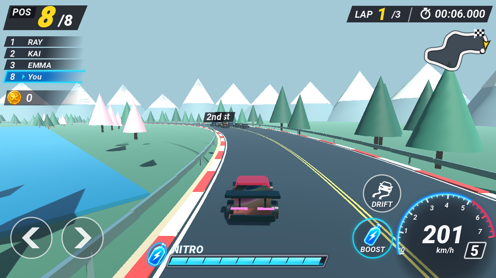

# Initial SJ — Alpine Rush

첨부 레퍼런스의 후방 추적 시점과 산악 도로, 드리프트·니트로 HUD를 바탕으로 새로 만든 **3D 아케이드 레이싱 프로토타입**입니다. 후지산과 가와구치호를 모티브로 한 생성형 파노라마, 소나무·벚꽃 이미지와 아스팔트·풀 텍스처를 사용합니다. 도로와 차량은 실시간 3D이며, 차량은 현재 로우폴리 프로토타입입니다.



[배경·도로 구성](docs/ENVIRONMENT.md) · [레퍼런스와 HUD 비교](docs/hud-comparison.html) · [HUD 배치와 시각 검증](docs/HUD.md)

## 실행

Godot 프로젝트 관리자에서 이 폴더의 `project.godot`을 가져온 뒤 **F6/F5**로 실행합니다. 별도 에셋 다운로드나 플러그인은 필요 없습니다.

```sh
godot --path new
```

- 요청 목표 버전: **Godot 4.7.2**.
- 실제 개발 환경과 실행·테스트 검증 버전: **Godot 4.6.3 stable**.
- 4.7.2 실행 파일이 이 환경에 없어서 해당 버전 검증은 하지 못했습니다. 프로젝트 기능 표시는 실제 확인한 `4.6 / GL Compatibility`를 사용합니다.
- 가로 화면 1280×720을 기준으로 UI를 조정합니다. 모바일에서는 멀티터치 조작을 제공합니다. 실제 모바일 기기의 성능과 터치는 별도 확인이 필요합니다.

## 조작

| 입력 | 동작 |
| --- | --- |
| Enter / START RACE | 경기 시작·재시작 |
| A, D / ←, → | 좌우 조향 |
| Space + 조향 | 드리프트, 점수 획득 및 니트로 회복 |
| Shift | 니트로 사용 |
| S / ↓ | 감속 |
| P / Esc / 우측 상단 랩·타이머 패널 | 일시정지·재개 |
| R | 경기 초기화 |
| M / V | 화면 움직임 완화 / 소리 켜기·끄기 |
| 화면 하단 버튼 | 터치·마우스 조작, 터치는 조향과 니트로 동시 입력 가능 |

자동으로 가속합니다. 드리프트는 79 km/h 이상에서 조향과 함께 입력해야 발동합니다. 도로 끝에 닿거나 다른 차량과 접촉하면 감속합니다. 3랩을 마치면 순위·시간·드리프트 점수를 보여 주고 최고 완주 시간을 `user://records.cfg`에 저장합니다. 창이 포커스를 잃으면 경기를 일시정지합니다.

[게임 감각 개선과 측정 결과](docs/GAME_FEEL.md)

## 구현 범위

- 후지산이 보이는 호숫가 코스, 생성형 파노라마와 가로수, 수면·호안 지형
- 생성형 아스팔트 질감, 미세 요철, 타이어 자국, 마모된 차선·연석
- 가드레일·연석·가로수의 MultiMesh 일괄 렌더링
- 플레이어 차량과 AI 차량 7대, 순위와 3랩 경기
- 속도에 반응하는 후방 카메라와 니트로 FOV 효과
- 드리프트 연기, 니트로 배기 효과, 니트로 잔량 및 회복
- 순위·랩·시간·미니맵·속도계·일시정지·결과 화면
- 주행·접촉·완주·재시작·멀티터치 상태의 자동 검사

주행은 코스 거리와 좌우 오프셋으로 계산합니다. 자유 주행용 타이어 물리나 `VehicleBody3D` 시뮬레이션은 아직 없고, AI는 차선과 목표 속도를 따라 달립니다. 현재 차고, 차량 구매, 사운드, 실제 3D 차량 모델 및 모바일 패키지는 구현하지 않았습니다. 코인 표시는 UI 전용이며 잔액·획득 시스템은 아직 연결하지 않았습니다. 기존 Flutter 버전의 기능은 자동으로 이식되지 않습니다.

## 구조

- `scripts/track.gd`: 코스 샘플링, 도로 UV, 차선·연석, 타이어 자국
- `scripts/fuji_environment.gd`: 생성형 배경, 호수, 호안 지형과 가로수
- `shaders/`: 후지산 배경·도로·차선·잔디·수면 재질
- `assets/environment/`: 생성형 원본 이미지와 가져오기 설정
- `scripts/car.gd`: 차량 모델과 드리프트·니트로 효과
- `scripts/race.gd`: 입력, 경기 상태, 주행, AI, 카메라, 기록
- `scripts/hud.gd`: 해상도 대응 HUD와 터치 입력
- `tests/race_test.gd`: 주요 주행 규칙 검사

## 검사

저장소 루트에서 실행합니다. 테스트는 완주 기록을 저장하지 않습니다.

```sh
godot --headless --path new --editor --import --quit
godot --headless --path new --script res://tests/race_test.gd
godot --headless --path new --quit-after 120
```

기존 Flutter 소스는 `../legacy/`에 있습니다. GitHub Pages의 첫 화면에서 두 게임을 선택할 수 있습니다. 새 게임 주소는 https://obmaz.github.io/initialsj/new/ 입니다. 웹 내보내기는 스레드를 사용하지 않으므로 GitHub Pages에 별도 COOP/COEP 헤더가 필요하지 않습니다. 웹 빌드 설정은 `export_presets.cfg`에 저장합니다.
