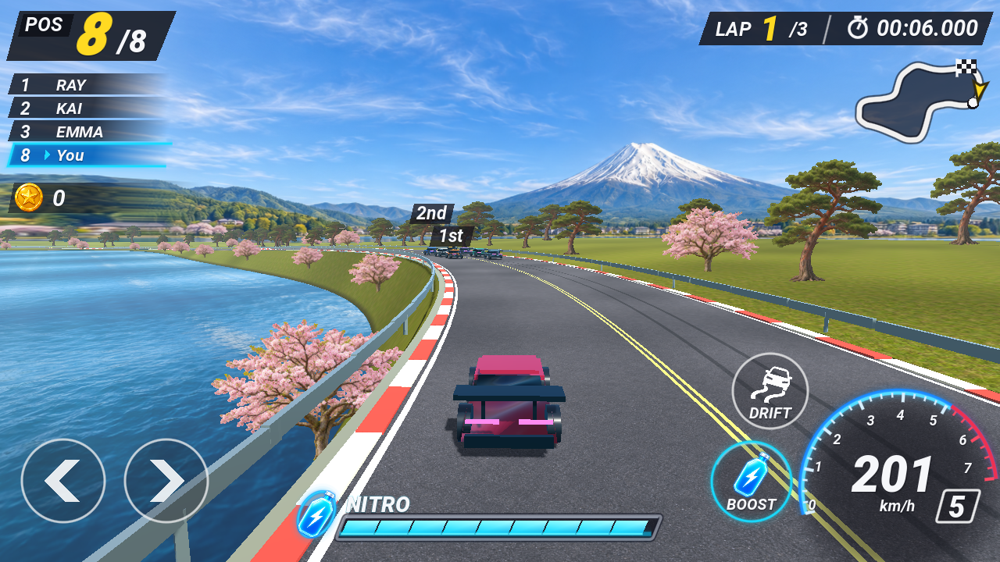

# Fuji Lakeside — 배경과 도로



사용자 콘셉트는 **후지산이 보이는 호수 옆 도로**입니다. 생성형 이미지 5종을 실제 3D 코스에 연결했습니다.

| 이미지 | 사용 |
| --- | --- |
| `fuji-lake-panorama.png` | 후지산, 호수, 맞은편 숲과 마을, 하늘의 원경 |
| `japanese-pine.png` | 투명 소나무 가로수 |
| `sakura-tree.png` | 투명 벚꽃 가로수. 배경을 제거하도록 재생성 |
| `asphalt.png` | 반복 가능한 회색 아스팔트 입자와 도로 표면 |
| `lakeside-grass.png` | 호안과 도로 바깥 지면의 풀 질감 |

후지산 이미지는 화면에 붙인 고정 그림이 아니라 카메라 방향에 반응하는 원경입니다. 시작 구간과 첫 커브에서 후지산을 볼 수 있도록 방향을 배치했습니다. 후지산 방향을 벗어나면 같은 이미지의 주변 산자락을 사용해 지평선을 이어 주고 산이 여러 번 복제되지 않도록 합니다. 물과 호안, 도로, 차량은 3D 공간에 있습니다. 가로수는 카메라를 향하는 이미지 판으로 구현했습니다.

도로 UV는 실제 거리 단위로 반복됩니다. 아스팔트 재질에는 미세 표면 요철과 넓은 마모 변화를 넣고, 커브를 따라 타이어 자국을 배치했습니다. 이 자국은 코스 장식이며 주행 중 영구 생성되는 타이어 흔적은 아닙니다. 차선·연석에도 마모된 페인트 재질을 사용합니다.

웹에서 많은 나무와 가드레일·연석을 표시하기 위해 MultiMesh로 묶어 렌더링합니다. 이미지 원본은 보존하고, 도로·풀·가로수는 최대 1024px와 밉맵으로 가져옵니다. 후지산 원경은 원본의 2:1 비율을 유지합니다. 웹에서 별도 압축 텍스처 확장을 요구하지 않도록 환경 텍스처의 3D 자동 VRAM 압축은 끕니다.

## 검증

- 주행·경기·터치 검사를 유지합니다.
- 도로 UV와 위쪽 법선, 수면의 법선, 호안 높이, 나무 투명도를 검사합니다.
- 네 방향의 주행 화면을 `tests/preview_environment.gd`로 캡처해 접합부와 가로수·도로 질감을 확인합니다.

```sh
godot --headless --path new --script res://tests/race_test.gd
godot --path new --script res://tests/preview_environment.gd
```
