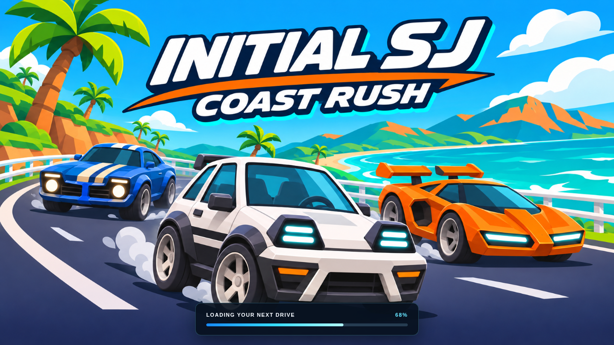

# Coast Rush loading screen

The first page paint shows bright mobile-game key art with chunky stylized vehicles, simple color planes and a cheerful coastal road. The white Nimori hatch, orange Veltrix wedge and blue Ironvale fastback use fictional fascia and lamp designs rather than real manufacturer badges or a production-car rendering. The image contains the Initial SJ / Coast Rush title. It is splash illustration, not an in-game screenshot.

- `assets/ui/coast-rush-splash.png`: generated artwork copied without visual edits. The original is preserved in the workspace's `generated_images/exec-d9c6b25a-3ce3-49c7-93fc-2b6c267dc4c2.png`.
- `project.godot`: uses the same artwork for the engine boot splash and a custom chevron icon for exported browser icons.
- `web/coast-rush-shell.html`: custom web export shell based on Godot's MIT-licensed template. The artwork appears before engine JS downloads. A real download progress bar changes to “Preparing your ride” when downloads finish, and the overlay is removed when startup succeeds. The image uses `object-fit: contain` to keep the title and cars visible across landscape aspect ratios. The art URL has a new version query so the previous realistic image is not reused from browser cache.
- Failed engine initialization retains a readable notice. A listener limited to startup also handles an exhausted WASM download rejection that can escape the runtime's `startGame` promise; it is removed after successful startup or failure.
- Landscape play only: portrait shows “Rotate to race” over the loading/game canvas. A media-query callback pauses the Godot countdown/race and clears touch holds; returning to landscape waits for explicit resume. Native mobile orientation is sensor landscape.
- The in-game models share the new signatures: Nimori tapered dual-bar popup pods and divided grille; Veltrix chevron lamps and split rear wing; Ironvale two round lamps with eyebrow strips, offset paint stripes, divided grille and paired horizontal taillights.
- Reduced-motion preference disables the indeterminate progress animation. Status/progress labels and a screen-reader title are provided.

After exporting the game, run:

```sh
node new/tests/loading_review.cjs
```

The test delays real JS/data requests to verify artwork before engine loading, checks three landscape layouts and the portrait rotation guide, checks reduced motion and actual progress, lets the game reach its garage, verifies real orientation callback delivery, and aborts the WASM download to verify the failure notice. Set `INITIALSJ_REVIEW_URL` for a deployed build and `INITIALSJ_LOADING_OUTPUT` to keep remote-review screenshots outside the source tree.



Only `new/` is changed. Existing engine/audio license notices remain in the project.
