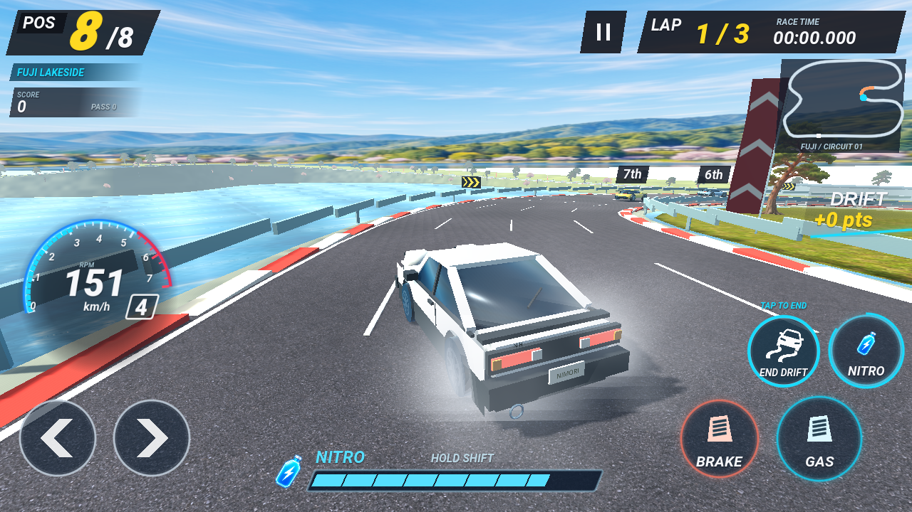

# Modes and shared-model garage

The home screen offers TOUR, TRACK and Settings. Both modes enter the same garage and use the same driving controls. Settings provide sound, reduced motion and a concise control reference; preferences are stored in `user://settings.cfg`.

TOUR retains five open-road stages, different left/right destinations and checkpoint timing. TRACK keeps the original Fuji lakeside art in a redesigned 4,357 m circuit: a long lakeside straight, climbing esses, a tight ridge hairpin, a 240 m tunnel and a downhill return. Elevation spans about 36.6 m and road width changes between sections. There are seven opponents and three laps. Track opponents never recycle; unwrapped progress determines rank while periodic world-space gaps handle collisions with lapped cars. There is one circuit and no Tour deadline in Track.

The garage shows one large vehicle and four performance bars. A single factory creates the exact same model, paint and nitro color for driving and showroom renders. Higher-resolution MSAA previews use a simple lit scene with a soft ground shadow; each model renders once on first selection and its texture is reused. The underlying race HUD is hidden behind home/garage screens. Three tabs change the selected car.

| Vehicle | Cruise km/h | Base acceleration m/s² | Boost km/h | Handling / 10 |
| --- | ---: | ---: | ---: | ---: |
| Nimori H | 259.2 | 28 | 313.2 | 10 |
| Veltrix S | 331.2 | 17 | 403.2 | 6 |
| Ironvale V8 | 288.0 | 34 | 360 / 388.8 cell | 4 |

These are arcade tuning values, not specifications for real cars. The ability bars derive speed, acceleration and boost from shared ranges; handling reflects steering/grip tuning. Nimori favors forgiving cornering and a rechargeable gauge; Veltrix trades launch and handling for speed and powerful shots; Ironvale trades steering response for launch power and hybrid nitro. Collision loss is common across cars.

Drift recovery now follows regained grip and unwound steering, so gentle curved sections do not hold an unnecessary drift indefinitely. Circuit AI previews corner braking and uses a bounded fraction of drift grip on tight turns, with visible drift angle/smoke near the player. Cruise pace varies deterministically across the grid. Raw scripted driving results are in `circuit-metrics.json` and `tour-metrics.json`; they are not human playtests.

Records use `coast_rush_v3`, separated by mode and car. The redesigned circuit uses `track_fuji_ridge_v1_best_time_*`, preserving earlier circular-circuit keys and v2 records. The driving HUD reduces the permanent route list to a small current-region badge; next destinations appear only near a fork, with overtakes subdued beside score. Track uses position, lap count and a circuit map.

`race_test.gd` includes garage and mode regression checks. `modes_checks.gd` covers menu/settings touch navigation, mode switching, loop continuity, three-lap finish, lapped-car separation and record isolation. `circuit_drive_review.gd` drives all three vehicles through a complete race and checks that opponents never teleport. Existing real keyboard and exported-browser tests cover entry through the new home screen.

CPU traffic now previews the braking distance to a slower car and rechecks an occupied merge path every tick. These checks use wrapped physical gaps on the circuit, so a car on another lap still blocks an unsafe merge or approach. Stationary traffic cannot move sideways. Sustained pack results are in `traffic-metrics.json`; targeted queue and merge regressions are included by `race_test.gd`.

## Race feedback pass

TRACK displays small projected place badges over nearby cars, limited to three and omitted when they overlap or crowd the main HUD. All eight drivers have unique places even when two grid-row distances match; ties use a stable grid order. Physical lap-wrapped proximity chooses visible badges, while total race progress determines their displayed place. TOUR keeps traffic free of race-place badges.

A visible pause button sits beside the time panel; the full time panel remains tappable. Circuit pause titles and headers identify the race correctly. Touch devices receive a tap-to-resume message and touch control references. `modes_checks.gd` verifies unique grid places and pause/resume touch handling, and the exported-browser touch review captures a real mobile pause dialog.

Drift trails now use the current road width instead of a fixed lane offset, keeping tire marks on wide outer lanes. `feedback_visual_review.gd` captures badges, phone layouts, the circuit pause dialog and wide-road trails. These are rendered review fixtures.

## Drift / RPM / lighting update

DRIFT/Space now toggles entry and exit, with a 0.55 s steering-entry window and no cooldown. Entry still needs 90 km/h and steering. Holding a tap cannot repeatedly toggle. The old gold charge ring is removed; the button switches to END DRIFT, with a brief state hint. Braking while steering retains a controlled drift; braking with unwound steering settles it. The original brake-tap entry remains available.

The tacho has a segmented RPM fill, bounded idle/redline and automatic gear changes. Gauge, gear display and audio pitch use the same shared calculation. Pause/result dialogs remove key instructions; the control reference remains in Settings.

Lighting combines a warm shadowed key and a cool fill excluded from sky rendering. Exposure is restrained, and the ridge tunnel reduces ambient/fill while nearby warm lamps and the player's headlights illuminate actual geometry. Local lights are distance limited and do not cast extra dynamic shadows. Steep lakeside terrain uses rock shading. New course geometry is included in independent world-space contact review: 324 cases now pass, including hairpins and S bends.
