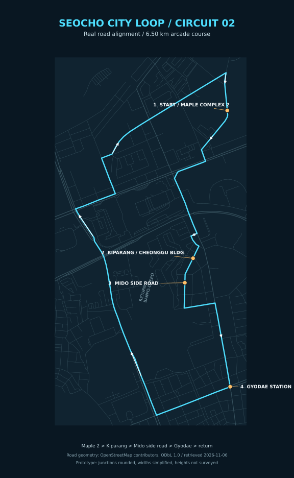

# 서초 시티 루프 — 트랙 02 지도 시안

메이플자이 2단지 옆 **나루터로4길**에서 출발해 신반포로33길·잠원로·서초중앙로·고무래로를 거쳐 **고무래로10길10 청구빌딩의 기파랑문해원**으로 향합니다. 이후 **고무래로10길의 미도아파트 서쪽 옆길**, **서초중앙로29길**, **서초중앙로**, **교대역 교차로**를 지납니다.

복귀 구간은 우선 서초대로 → 반포대로 → 신반포로 → 잠원로3길·4길 → 나루터로4길로 잡았습니다. 사용자가 지정한 경유지를 순서대로 연결하고, 동일한 도로를 왕복해 겹치는 구간을 피한 시안입니다. 확정된 실제 내비게이션 경로를 뜻하지 않습니다.

- 출발 단지: [메이플자이 2단지, 신반포로253](https://juso.app/b/59pmsda6w7f902yb). 사유지 내부 대신 단지 옆 공공 도로에 출발선을 배치했습니다.
- 학원: [공식 오시는 길](https://banpo.kiparang.co.kr/new_prog/map.aspx)의 현재 1관 주소인 **고무래로10길10, 청구빌딩6층**을 사용합니다. 공식 페이지의 좌표는 위도37.5018943, 경도127.0104840입니다. 다른 관을 뜻했다면 해당 경유지만 조정할 수 있습니다.
- 미도 옆길: OSM의 고무래로10길 way185582677 및 서초중앙로29길 way185582682.
- 교대역: 서초중앙로·서초대로 교차로를 경유합니다.
- 원본 도로 형상: [OpenStreetMap](https://www.openstreetmap.org/#map=16/37.503/127.010), © OpenStreetMap contributors, [ODbL1.0](https://www.openstreetmap.org/copyright). 2026-11-06 공개 Overpass 데이터 조회. 사용한 원본 좌표·도로 ID와 단순화한 좌표는 [seocho-osm-route.json](../data/seocho-osm-route.json)에 함께 보관합니다.

실제 도로 좌표를 미터 단위로 변환했습니다. 게임 코스는 약 **6.50km**이며, 교차로는 최대35m 범위에서 둥글게 하고 좁은 옆길과 대로의 폭을 구분했습니다. 건물 배치·도로 폭·고도는 정밀 실측 재현이 아닌 게임용 시안입니다. 실제 신호·일방통행 규칙을 재현하는 내비게이션이 아니라 차량8대가 달리는 폐쇄형3랩 레이스입니다. 후지 코스와 차량별 기록을 별도로 저장합니다.

## 임시 실사 배경

현재 연결에서는 Street View·로드뷰 직접 캡처에 접근할 수 없어, 아래 확인된 **현장 사진 원본**을 사용했습니다. 구글 스트리트뷰 캡처나 연속된360도 파노라마라고 표시하지 않습니다. 사진의 촬영 연도 차이가 있어 현재 풍경과 다릅니다. 건물 외벽 및 임시 원경 배경에 사용하며, 원본의 표시를 지우거나 생성형 이미지로 바꾸지 않았습니다.

| 사용 위치 | 촬영·게시 시점 | 출처 |
| --- | --- | --- |
| 메이플자이 GATE2-2 | 2025-07-14 | [매일경제](https://www.mk.co.kr/news/realestate/11366676) |
| 청구빌딩1층 외벽 — 학원과 같은 건물, 학원 내부 사진 아님 | 촬영일 미표기 | [마루심 공식 홈페이지](https://marusim.co.kr/store/stores-detail.php?idx=1) |
| 반포미도아파트 전경 | 2017-09-13 | [대한경제](https://www.cnews.co.kr/m_home/view.jsp?idxno=201709131426419710869) |
| 교대역 교차로 | 2015-02 | [서울연구원 서울연구데이터서비스](https://data.si.re.kr/photo/05o01302dc8000), 통합코드05O01302Dc8000 |

전체 원본 이미지 URL·촬영 정보·출처 표기는 [seocho-photo-sources.json](../data/seocho-photo-sources.json)에 기록했습니다. 실제 운전 환경과 사진 투영은 정밀 정합된 것이 아니며, 먼저 지역 분위기를 비교하기 위한 임시 배경입니다.
